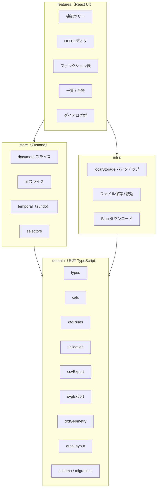
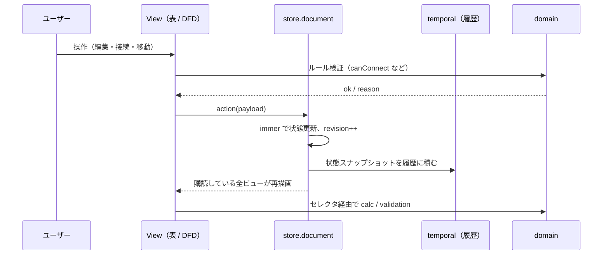
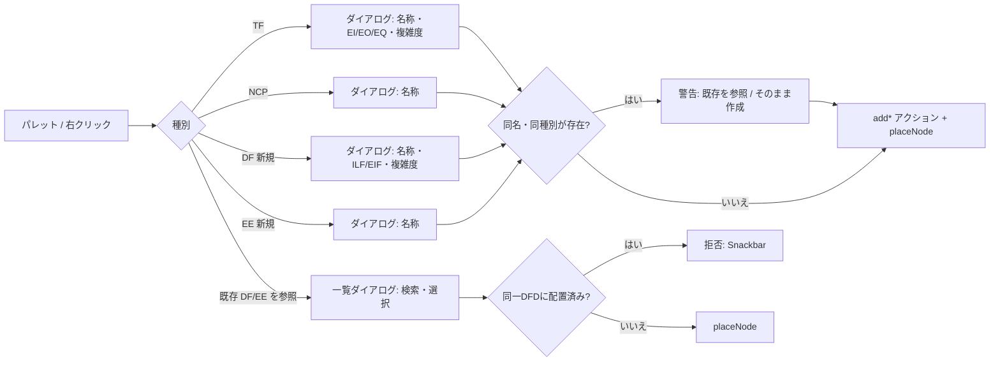
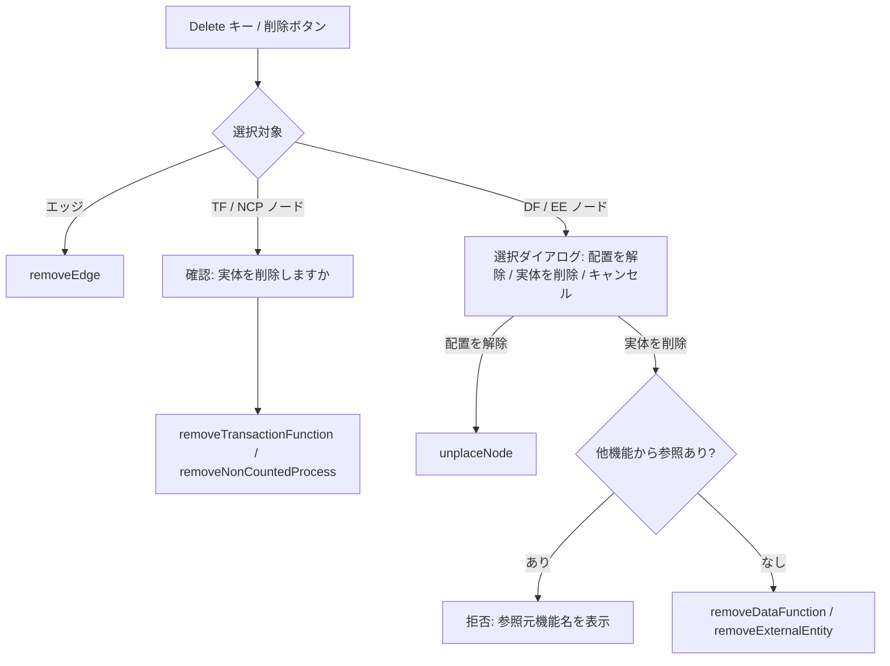
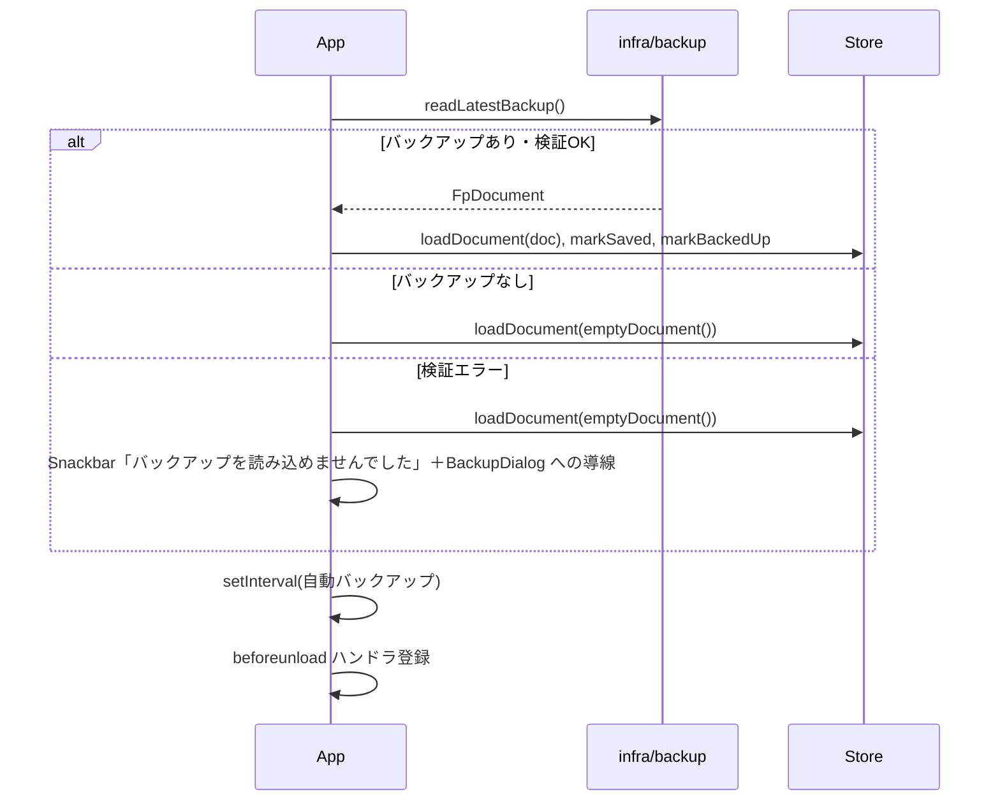

# 設計書: FP法見積もり用 DFD GUIエディタ

- 版: 1.0（2026-11-02）
- 入力: [requirements.md](./requirements.md)（要件定義書 1.0）
- 本書は要件定義書の FR-xx / NFR-xx / A-xx を実現するための設計を定める。要件番号は本文中で `[FR-DF-06]` のように参照し、第13章に対応表を置く。

---

## 1. 設計方針と技術スタック

### 1.1 設計方針

| 方針 | 内容 |
|---|---|
| 単一のストアから全ビューを導出する | 「表とDFDの双方向同期」[FR-FN-09][FR-DF-07][FR-DF-09] は同期処理ではなく、1つの正規化ストアを表・DFD・一覧がそれぞれ参照することで実現する。同期ずれが構造的に起きない。 |
| ドメインロジックを React から分離する | 計算・検証・CSV/SVG生成・接続ルールは純粋な TypeScript モジュールにし、UI なしで単体テストできるようにする。 |
| 履歴対象を限定する | Undo/Redo はドキュメント状態のみを対象とし、選択状態やズームなどの UI 状態は含めない。 |
| 出力はデータから生成する | SVG は DOM のシリアライズではなくストアのデータから生成し、ズームや画面サイズに依存しない [FR-SVG-02]。 |
| サーバーを持たない | すべての処理をブラウザ内で完結させる [NFR-05]。 |

### 1.2 技術スタック

| 用途 | ライブラリ | 備考 |
|---|---|---|
| ビルド / 開発サーバー | Vite | 静的ファイルとして出力。`base: './'` で任意のパスから動作させる |
| 言語 | TypeScript（strict） | |
| UI フレームワーク | React 18 | |
| UI 部品 | MUI: `@mui/material`、`@mui/icons-material`、`@mui/x-data-grid`、`@mui/x-tree-view` | DataGrid・TreeView は Community 版の範囲で使用 |
| DFD キャンバス | React Flow（`@xyflow/react` v12） | カスタムノード、`isValidConnection`、MiniMap、Controls |
| 自動整列 | `@dagrejs/dagre` | 階層レイアウト（左→右） |
| 状態管理 | Zustand ＋ `immer` ミドルウェア | 正規化ストア |
| Undo / Redo | zundo（`temporal` ミドルウェア） | document スライスのみ対象 |
| スキーマ検証 | zod | JSON 読み込み時の検証 |
| ID 生成 | nanoid | |
| 日付 | 標準 `Date` ＋ `Intl.DateTimeFormat` | 依存を増やさない |
| 単体テスト | Vitest ＋ React Testing Library | |
| E2E テスト | Playwright | ダウンロード・localStorage 復元の検証 |
| Lint / Format | ESLint（typescript-eslint、react-hooks）＋ Prettier | |

バージョンは実装開始時点の最新安定版を `package.json` に固定する。

---

## 2. アーキテクチャ

### 2.1 レイヤ構成



依存ルール:

- `domain` は他のレイヤに依存しない。React、Zustand、DOM API を import しない（`svgExport` も文字列を返すのみ）。
- `store` は `domain` のみに依存する。
- `infra` は `domain` と DOM API（`localStorage`、`Blob`、`URL`）に依存する。
- `features` は `store`、`infra`、`domain` を利用できる。
- ESLint の `import/no-restricted-paths` で上記を強制する。

### 2.2 ディレクトリ構成

```
src/
  domain/
    types.ts            エンティティ型・ドキュメント型
    ids.ts              nanoid ラッパ、表示用連番
    calc.ts             FP・工数・費用計算
    fpTables.ts         係数テーブル、C1〜C14 名称
    dfdRules.ts         接続ルール
    dfdGeometry.ts      ノード寸法定数
    autoLayout.ts       dagre 呼び出し
    validation.ts       警告の検出
    csvExport.ts        CSV 文字列生成
    svgExport.ts        SVG 文字列生成
    schema.ts           zod スキーマ
    migrations.ts       schemaVersion 移行
    emptyDocument.ts    初期ドキュメント生成
  store/
    documentSlice.ts    ドキュメント状態とアクション
    uiSlice.ts          UI 状態
    index.ts            createStore（immer + temporal）
    selectors.ts        派生値セレクタ
    hooks.ts            useFeatureResult 等
  infra/
    backup.ts           localStorage バックアップ
    fileIo.ts           JSON 保存・読込
    download.ts         Blob ダウンロード
  features/
    app/                AppShell、Toolbar、StatusBar、レイアウト
    tree/               FeatureTree
    dfd/                DfdCanvas、nodes/、edges/、palette、dialogs
    functions/          FunctionTable、CharacteristicsEditor
    summary/            SummaryTable、FunctionLedger
    properties/         PropertyPanel
    settings/           SettingsDialog、VendorEditor、BackupDialog
    common/             ConfirmDialog、useSnackbar、useGlobalShortcuts
  main.tsx
  App.tsx
test/
  e2e/                  Playwright
```

### 2.3 データの流れ



---

## 3. ドメインモデル（型定義）

要件定義書 3.2 のネスト構造を、ストアおよび保存ファイルでは **正規化形式** で持つ。親子関係は親側の ID 配列（表示順を兼ねる）で表す。

```ts
// src/domain/types.ts
export type Id = string;

export type Complexity = 'low' | 'medium' | 'high';
export type DataFunctionKind = 'ILF' | 'EIF';
export type TransactionKind = 'EI' | 'EO' | 'EQ';
export type DevType = 'new' | 'modification';

export interface Project {
  id: Id;
  name: string;
  softwareIds: Id[];
}

export interface Software {
  id: Id;
  name: string;
  category1Ids: Id[];
  settings: SoftwareSettings;
  vendorIds: Id[];
  seq: { DF: number; TF: number; EE: number }; // 表示用連番の次番号
}

export interface DevTypeSettings {
  modificationFactor: number; // 改修係数。初期値 1.00
  hoursPerFp: number | null;  // H/FP。null は未設定（警告対象）
}

export interface SoftwareSettings {
  defaultCharacteristics: number[]; // 長さ14、各 0〜5
  newDev: DevTypeSettings;
  modDev: DevTypeSettings;
  inHouseRatio: number; // 0〜1
  inHouseRate: number;  // 円/H
}

export interface Category1 { id: Id; softwareId: Id; name: string; category2Ids: Id[]; }
export interface Category2 { id: Id; category1Id: Id; name: string; featureIds: Id[]; }

export interface Feature {
  id: Id;
  category2Id: Id;
  name: string;
  devType: DevType;
  characteristics: number[]; // 長さ14
  vendorId: Id | null;
  description: string; // 説明（任意）。既定は空文字
  dfd: Dfd;
}

export interface DataFunction {
  id: Id;
  softwareId: Id;
  displayNo: string; // "DF-001"
  name: string;
  kind: DataFunctionKind;
  complexity: Complexity;
  ownerFeatureId: Id | null; // null = 所有機能未設定
  description: string;       // 配置理由など（任意）
}

export interface TransactionFunction {
  id: Id;
  featureId: Id;
  displayNo: string; // "TF-001"
  name: string;
  kind: TransactionKind;
  complexity: Complexity;
  description: string;
}

export interface NonCountedProcess { id: Id; featureId: Id; name: string; description: string; }

export interface ExternalEntity { id: Id; softwareId: Id; displayNo: string; name: string; description: string; }

export interface Vendor { id: Id; softwareId: Id; name: string; rate: number; }

export type NodeRefType =
  | 'dataFunction' | 'transactionFunction' | 'nonCountedProcess' | 'externalEntity';

export interface DfdNode {
  id: Id;          // ノード自身のID（DFD内で一意）
  refType: NodeRefType;
  refId: Id;       // 実体エンティティのID
  x: number;
  y: number;
}

export interface DfdEdge { id: Id; sourceNodeId: Id; targetNodeId: Id; label: string; }

export interface Dfd { nodes: DfdNode[]; edges: DfdEdge[]; }

export interface FpDocument {
  schemaVersion: 1;
  project: Project;
  softwares: Record<Id, Software>;
  category1s: Record<Id, Category1>;
  category2s: Record<Id, Category2>;
  features: Record<Id, Feature>;
  dataFunctions: Record<Id, DataFunction>;
  transactionFunctions: Record<Id, TransactionFunction>;
  nonCountedProcesses: Record<Id, NonCountedProcess>;
  externalEntities: Record<Id, ExternalEntity>;
  vendors: Record<Id, Vendor>;
  backupSettings: { intervalSec: number; generations: number }; // 既定 60 / 10
}
```

設計上の補足:

- `DfdNode.id` と `refId` を分けるのは、同じ実体を複数機能のDFDに参照配置するためである。同一DFD内では `refId` の重複を禁止する [FR-DF-03]。
- `DataFunction.ownerFeatureId` が null の状態を許容するのは A-03（機能削除時に残す）のため。
- `hoursPerFp` の null は A-04 の「未入力時は 0 として扱い警告」を表す。計算時は 0 として扱う。
- `backupSettings` をドキュメントに含めるのは、プロジェクトごとに設定を持ち運べるようにするため [FR-SV-03]。

---

## 4. 状態管理設計

### 4.1 スライス構成

```ts
interface DocumentSlice {
  doc: FpDocument;
  revision: number;        // アクションごとに +1。履歴対象
  savedRevision: number;   // 最後に手動保存した revision。履歴対象外
  backedUpRevision: number;// 最後にバックアップした revision。履歴対象外
  // actions ...
}

interface UiSlice {
  selectedSoftwareId: Id | null;
  selectedFeatureId: Id | null;
  activeTab: 'dfd' | 'functions' | 'summary' | 'ledger';
  selectedNodeIds: Id[];
  selectedEdgeId: Id | null;
  dialog: DialogState | null;   // 開いているダイアログの種別と引数
  snackbar: SnackbarState | null;
}
```

ストア生成:

```ts
export const useStore = create<DocumentSlice & UiSlice>()(
  temporal(
    immer((set, get) => ({ ...createDocumentSlice(set, get), ...createUiSlice(set, get) })),
    {
      partialize: (s) => ({ doc: s.doc, revision: s.revision }),
      limit: 100,
      equality: (a, b) => a.revision === b.revision,
    },
  ),
);
```

- `partialize` により `doc` と `revision` のみが履歴に入る。UI 状態は Undo の影響を受けない [FR-DF-10]。
- `equality` で `revision` が変わらない更新（`savedRevision` の更新など）は履歴に積まない。
- ノードドラッグ中は `useStore.temporal.getState().pause()` し、`onNodeDragStop` で `resume()` 後に 1 回だけ `moveNodes` を呼ぶ。これで移動が 1 履歴になる。

### 4.2 アクション一覧

すべてのアクションは `revision++` を伴う（履歴対象）。UI スライスのアクションは `revision` を変えない。

| 領域 | アクション | 引数 | 補足 |
|---|---|---|---|
| プロジェクト | `renameProject` | name | [FR-PJ-01] |
| ソフトウェア | `addSoftware` / `renameSoftware` / `removeSoftware` | name / id | 削除は配下すべてをカスケード [FR-PJ-02] |
| 設定 | `updateSettings` | softwareId, Partial\<SoftwareSettings\> | [FR-PJ-04] |
| 外注業者 | `addVendor` / `updateVendor` / `removeVendor` | | 削除時は参照している Feature の `vendorId` を null に [FR-PJ-05] |
| 分類 | `addCategory1` / `addCategory2` / `renameCategory` / `removeCategory` / `moveCategory` | parentId, name / id / id, newIndex | 削除はカスケード [FR-CT-01〜03] |
| 機能 | `addFeature` | category2Id, name | 既定値コピー、devType='new'、空の DFD [FR-CT-05] |
| 機能 | `updateFeature` | id, Partial\<Feature\> | 名称・開発区分・C1〜C14・業者・説明 |
| 機能 | `removeFeature` | id | 所有 DF は `ownerFeatureId=null`、TF / NCP は削除、他機能の DFD にある参照は維持 [FR-CT-04] |
| 機能 | `moveFeature` | id, category2Id, newIndex | [FR-CT-02] |
| 機能 | `resetCharacteristics` | id | 既定値で上書き [FR-FN-06] |
| DF | `addDataFunction` | featureId, name, kind, complexity, placeOnDfd | 所有機能＝featureId。`placeOnDfd` 時はノードも追加 [FR-FN-03] |
| DF | `updateDataFunction` | id, Partial | 所有機能変更・説明を含む。TF / NCP / EE の `update*` も同様に説明を受け付ける |
| DF | `removeDataFunction` | id | 全 DFD からノード・接続エッジも除去。他機能が参照中なら拒否 [FR-DF-08] |
| TF | `addTransactionFunction` / `updateTransactionFunction` / `removeTransactionFunction` | | TF 削除はノード・エッジも除去 |
| NCP | `addNonCountedProcess` / `updateNonCountedProcess` / `removeNonCountedProcess` | | |
| EE | `addExternalEntity` / `updateExternalEntity` / `removeExternalEntity` | | 参照中なら拒否 |
| DFD | `placeNode` | featureId, refType, refId, position? | 参照配置。重複は拒否 [FR-DF-03] |
| DFD | `unplaceNode` | featureId, nodeId | 配置解除（実体は残す） |
| DFD | `moveNodes` | featureId, {nodeId, x, y}[] | |
| DFD | `addEdge` / `updateEdgeLabel` / `removeEdge` | | `canConnect` 済みであることを呼び出し側が保証 |
| DFD | `connectEntities` | featureId, source, target, label | 実体（refType, refId）同士を接続する。未配置の実体は相手の右隣の空き位置に自動配置し、配置と接続を 1 履歴にする [FR-FN-15] |
| DFD | `applyLayout` | featureId, {nodeId, x, y}[] | 自動整列の結果を適用。`moveNodes` と同じ更新だが名称で意図を区別 [FR-DF-12] |
| DFD | `pasteNodes` | featureId, clipboard | 同一ソフトウェア内のコピー。DF/EE は参照として配置、TF/NCP は複製 [FR-DF-11] |
| 文書 | `loadDocument` | FpDocument | 読み込み。履歴はクリア |
| 文書 | `markSaved` / `markBackedUp` | revision | 履歴対象外 |
| 文書 | `updateBackupSettings` | | |

### 4.3 セレクタ

| セレクタ | 戻り値 | 用途 |
|---|---|---|
| `selectFeatureTree(softwareId)` | ツリー表示用のネスト構造 | 機能ツリー |
| `selectFeaturePath(featureId)` | `{software, category1, category2, feature}` | タイトル、SVG、CSV |
| `selectFeatureFunctions(featureId)` | 所有 DF、参照 DF、TF、NCP | ファンクション表 |
| `selectDfdView(featureId)` | React Flow の `Node[]`、`Edge[]` | DFD キャンバス |
| `selectFeatureResult(featureId)` | `FeatureResult` | 計算結果 |
| `selectSoftwareTotals(softwareId)` | 合計行 | 一覧タブ |
| `selectLedger(softwareId)` | 台帳行（参照元機能のリスト、説明付き） | ファンクション台帳、台帳 CSV |
| `selectWarnings(softwareId)` | `Warning[]` | ステータスバー、ハイライト |
| `selectIsDirty()` | `revision !== savedRevision` | 未保存判定 |

React Flow 用の `selectDfdView` は `useShallow` で購読し、`Node` オブジェクトは `(nodeId, x, y, 実体の名前・種別・複雑度・所有機能名, 警告有無)` から `useMemo` で生成する。実体が変わらなければ参照を保つことで React Flow の再描画を抑える [NFR-02]。

---

## 5. 計算モジュール設計

### 5.1 定数

```ts
// src/domain/fpTables.ts
export const FP_WEIGHTS: Record<DataFunctionKind | TransactionKind, Record<Complexity, number>> = {
  ILF: { low: 7, medium: 10, high: 15 },
  EIF: { low: 5, medium: 7, high: 10 },
  EI:  { low: 3, medium: 4, high: 6 },
  EO:  { low: 4, medium: 5, high: 7 },
  EQ:  { low: 3, medium: 4, high: 6 },
};
export const CHARACTERISTIC_NAMES: string[] = ['データ通信', '分散データ処理', /* … */ '変更容易性'];
export const VAF_BASE = 0.65;
export const VAF_STEP = 0.01;
```

### 5.2 関数

```ts
// src/domain/calc.ts
export interface FunctionCounts { ILF: number; EIF: number; EI: number; EO: number; EQ: number; }

export interface FeatureResult {
  counts: FunctionCounts;        // CSV の件数列
  unadjustedFp: number;
  vaf: number;                   // 調整係数（小数第2位に丸めて保持）
  adjustedFp: number;
  modificationFactor: number;
  hoursPerFp: number;            // null は 0 として扱った値
  effortHours: number;
  inHouseHours: number;
  outsourceHours: number;
  vendorId: Id | null;
  cost: number;                  // 開発単価（円）
}

export function calcUnadjustedFp(fns: { kind; complexity }[]): number;
export function calcVaf(characteristics: number[]): number;        // 0.65 + 0.01 × Σ、小数第2位で四捨五入
export function calcAdjustedFp(unadjusted: number, vaf: number): number; // Math.floor
export function calcEffort(adjustedFp: number, factor: number, hoursPerFp: number): number; // Math.floor
export function calcSplit(effort: number, ratio: number): { inHouse: number; outsource: number }; // floor / 残り
export function calcCost(inHouse, inHouseRate, outsource, vendorRate: number | null): number;
export function calcFeatureResult(doc: FpDocument, featureId: Id): FeatureResult;
export function calcSoftwareTotals(doc: FpDocument, softwareId: Id): SoftwareTotals;
```

端数処理の注意:

- `calcVaf` は浮動小数誤差を避けるため整数演算で行う: `(65 + sum) / 100`。
- `calcAdjustedFp` は `Math.floor(Math.round(unadjusted * vaf * 1000) / 1000)` のように、1e-9 程度の誤差で切り捨てが 1 ずれないよう丸めてから floor する。`21 × 0.93 = 19.53` のようなケースで `19.529999…` を避ける。
- `calcEffort`、`calcSplit` も同様に丸めてから floor する。

### 5.3 件数の数え方 [FR-ID-02][FR-ID-03]

- DF: `dataFunctions` のうち `ownerFeatureId === featureId` のもの。
- TF: `transactionFunctions` のうち `featureId === featureId` のもの。
- DFD に配置されているかどうかは件数に影響しない（表で追加したが未配置のものも数える）。

### 5.4 テストケース

| ケース | 入力 | 期待値 |
|---|---|---|
| 要件 4.6.9 | ILF中1, EI中1, EO低1, EQ低1、C合計28、新規(1.00, 8.0)、比率0.40、社内6000、A社5000 | UFP 21、VAF 0.93、AFP 19、工数152、社内60、外注92、費用820,000 |
| 要件 10.1 行2 | EQ低2、C合計28、改修(0.50, 8.0)、B社5000 | UFP 6、AFP 5、工数20、社内8、外注12、費用108,000 |
| VAF 下限 | C 全て0 | 0.65 |
| VAF 上限 | C 全て5 | 1.35 |
| 切り捨て境界 | UFP 100、VAF 0.99 | AFP 99 |
| 浮動小数 | UFP 21、VAF 0.93 | AFP 19（19.53 → 19） |
| hoursPerFp 未設定 | null | 工数 0、警告 |
| 業者未選択・外注>0 | vendorId null、比率0.4 | 外注分費用 0、警告 [4.6.5] |
| 比率 1.0 | | 外注 0、警告なし [A-11] |
| 参照 DF | 所有機能 A、参照機能 B | B の件数に含まれない |

---

## 6. DFDエディタ設計

### 6.1 React Flow へのマッピング

| ストア | React Flow | 備考 |
|---|---|---|
| `DfdNode` ＋ 実体 | `Node<DfdNodeData>`、`type` = refType | `data` に名称・種別・複雑度・displayNo・所有機能名・isReference・hasWarning・description・hasDescription |
| `DfdEdge` | `Edge`、`type: 'dataflow'` | `label` を表示。`markerEnd: arrowclosed` |
| `moveNodes` | `onNodeDragStop` | ドラッグ中は `onNodesChange` で React Flow 内部状態のみ更新 |
| `addEdge` | `onConnect` ＋ `isValidConnection` | |
| `removeEdge` / 削除フロー | `onEdgesDelete` / `onBeforeDelete` | ノード削除は `onBeforeDelete` で false を返し、独自の削除フロー（6.5）に委ねる |
| 選択 | `onSelectionChange` → `uiSlice.selectedNodeIds` | |

React Flow の `nodes` / `edges` は **controlled** とし、ストアから導出した配列を渡す。`onNodesChange` では位置変更と選択変更のみローカルに反映し（`applyNodeChanges`）、確定時にストアへ書く。

### 6.2 カスタムノード [FR-DF 4.4.1]

寸法は `domain/dfdGeometry.ts` に定数として置き、ノードコンポーネントと SVG 生成で共有する。

```ts
export const GEOMETRY = {
  process: { radius: 44 },                       // 円。直径 88
  dataStore: { width: 180, height: 44, lineGap: 44 },
  externalEntity: { width: 140, height: 60 },
  badge: { width: 28, height: 16, fontSize: 10 },
  label: { fontSize: 12, fontFamily: '"Hiragino Sans","Noto Sans JP","Meiryo",sans-serif' },
  referenceNote: { fontSize: 10 },
  handleOffset: 0,
};
```

| ノード type | コンポーネント | 描画 |
|---|---|---|
| `transactionFunction` | `ProcessNode` | 円。上部に種別バッジ（EI 青 / EO 緑 / EQ 橙）、中央に名称、下部に複雑度（低中高）と displayNo |
| （共通） | — | `hasDescription` のノードは右上に 12px のメモアイコンを描き、MUI `Tooltip` で説明全文を表示する [FR-DF-16]。説明は図形内に描画せず、SVG 出力にも含めない |
| `nonCountedProcess` | `ProcessNode`（variant=nonCounted） | 破線の円、淡色背景、名称のみ |
| `dataFunction` | `DataStoreNode` | 上下2本の水平線、左端に種別バッジ（ILF 紫 / EIF 灰）、名称。参照時は下に「所有: ○○」を小さく表示。所有機能未設定は警告色の枠 |
| `externalEntity` | `ExternalEntityNode` | 四角、名称 |

各ノードは上下左右に `Handle`（`type="source"` と `type="target"` を重ねて配置）を持ち、どの方向からも接続できるようにする。接続点は React Flow の `ConnectionMode.Loose` を使う。

### 6.3 接続ルール [FR-DF-06]

```ts
// src/domain/dfdRules.ts
export type NodeKindForRule = 'process' | 'dataStore' | 'externalEntity';

export function canConnect(source: NodeKindForRule, target: NodeKindForRule): { ok: true } | { ok: false; reason: string } {
  if (source === 'process' || target === 'process') return { ok: true };
  return { ok: false, reason: `${label(source)}と${label(target)}は直接接続できません。プロセスを介してください。` };
}
```

- `refType` → `NodeKindForRule` の変換: transactionFunction / nonCountedProcess → process、dataFunction → dataStore、externalEntity → externalEntity。
- 自己接続（source === target ノード）は禁止。
- 同じ向きの重複エッジは許可する（複数のデータフローがあり得るため）。
- `isValidConnection` が false を返した場合、React Flow は接続を作らない。加えて `onConnectEnd` で直前の拒否理由を Snackbar に表示する。

### 6.4 ノード追加と参照配置



- 配置位置: パレットからのドラッグ&ドロップはドロップ座標、ボタン / ダイアログ経由はビューポート中央付近の空き位置（既存ノードと重ならない位置を 40px 刻みで探索）。表から追加した場合も同じ探索で自動配置する [FR-DF-09]。
- 同名チェックは `validation.findDuplicateName()` を使い、作成はブロックしない [FR-ID-04]。
- すべての追加ダイアログに「説明（任意）」の複数行欄を置く [FR-DF-02][FR-FN-12]。

### 6.5 削除フロー [FR-DF-08]



複数選択時は種別ごとにまとめて確認し、DF / EE が含まれる場合は上記の選択ダイアログを 1 回表示して全件に適用する。

### 6.6 自動整列 [FR-DF-12]

```ts
// src/domain/autoLayout.ts
export function layoutDfd(nodes: {id, kind, width, height}[], edges: {source, target}[]): {id, x, y}[]
```

- dagre 設定: `rankdir: 'LR'`、`nodesep: 40`、`ranksep: 80`、`ranker: 'network-simplex'`。
- 外部エンティティを左、データストアを右に寄せるため、エッジがないノードには仮想エッジを追加せず、代わりに `rank` を疑似的に揃える: 外部エンティティは `rank=min`、孤立データストアは `rank=max` になるよう、孤立ノードは整列後に左端 / 右端の列へ手動配置する。
- 結果は `applyLayout` で一括適用し、1 履歴とする。
- 整列後に `fitView()` を呼ぶ。

### 6.7 ズーム・パン・ミニマップ [FR-DF-13][FR-DF-14]

- React Flow の `Controls`（＋ / − / fitView / ロック）と `MiniMap` を配置する。
- ホイールでズーム、ドラッグでパン（既定）。`minZoom: 0.2`、`maxZoom: 2`。
- ビューポートは UI 状態として機能ごとに保持し、機能を切り替えて戻った時に復元する（履歴対象外、保存対象外）。

### 6.8 キーボードショートカット [FR-DF-11]

`features/common/useGlobalShortcuts.ts` で `window` の `keydown` を 1 箇所で処理する。

| キー | 動作 | 入力要素フォーカス中 |
|---|---|---|
| Ctrl/Cmd+S | 手動保存 | 有効 |
| Ctrl/Cmd+Z | Undo | 無効 |
| Ctrl/Cmd+Shift+Z、Ctrl+Y | Redo | 無効 |
| Delete / Backspace | 選択ノード・エッジの削除フロー | 無効 |
| Ctrl/Cmd+A | DFD の全ノード選択 | 無効 |
| Ctrl/Cmd+C | 選択ノードをクリップボード（ストア内メモリ）にコピー | 無効 |
| Ctrl/Cmd+V | 貼り付け。TF / NCP は複製、DF / EE は参照配置。ソフトウェアが異なる場合は拒否 | 無効 |
| Escape | 選択解除、ダイアログを閉じる | 有効 |

React Flow 自身のショートカット（`deleteKeyCode`、`multiSelectionKeyCode`）は無効化し、本フックに統一する。

---

## 7. UI コンポーネント設計

### 7.1 レイアウトと MUI 部品

見た目の詳細（寸法、色、タイポグラフィ、各状態の表現）は [ui-design.md](./ui-design.md) とモック [ui/mock/index.html](./ui/mock/index.html) を正とする。

```
AppShell
├─ Toolbar（MUI AppBar + Toolbar）
├─ 本体（CSS Grid: 左 280px / 中央 1fr / 右 320px、ドラッグでリサイズ可）
│   ├─ FeatureTree（@mui/x-tree-view RichTreeView）
│   ├─ パンくず ＋ CostBar（中央ペイン上部に固定）
│   ├─ Tabs（MUI Tabs）: DfdCanvas / FunctionTable / SummaryTable / FunctionLedger
│   └─ PropertyPanel（MUI Paper + TextField / Select）
└─ StatusBar（MUI Box）
```

### 7.2 コンポーネント一覧

| コンポーネント | 責務 | 参照するストア |
|---|---|---|
| `Toolbar` | 新規 / 開く / 保存 / Undo / Redo / CSV出力 / SVG出力 / 自動整列 / 設定 | `selectIsDirty`、temporal の `pastStates.length` |
| `CostBar` | パンくず行の右端に、選択中機能の開発単価と `selectSoftwareTotals` の開発単価合計を常時表示 [FR-FN-13] | `selectFeatureResult`、`selectSoftwareTotals` |
| `FeatureTree` | プロジェクト→ソフトウェア→大→中→機能の表示、選択、追加・改名（インライン編集）・削除・並べ替え（ドラッグ） | `selectFeatureTree`、`selectedFeatureId` |
| `DfdCanvas` | React Flow のホスト。`ReactFlowProvider` で包む。パレット、Controls、MiniMap | `selectDfdView` |
| `NodePalette` | 追加ボタン群（TF / NCP / DF / EE / 参照） | — |
| `FunctionTable` | 選択中機能のファンクション表（DataGrid）と DFD プレビュー。機能の説明・開発区分・外注業者・C1〜C14 は PropertyPanel（機能のプロパティ）で編集する | `selectFeatureFunctions` |
| `CharacteristicsEditor` | C1〜C14 の 14 個の Select（0〜5）。PropertyPanel（機能のプロパティ）と SettingsDialog（既定値）で使う | `feature.characteristics` |
| `SummaryTable` | 全機能の計算結果（DataGrid）＋合計行（`pinnedRows` 相当は Community 版に無いため、フッタ行を独自描画） | `selectFeatureResult` × 機能数、`selectSoftwareTotals` |
| `FunctionLedger` | ソフトウェア内の全 DF / TF（DataGrid）。所有機能の変更、参照元機能の一覧、説明の編集、台帳 CSV 出力 [FR-ID-06] | `selectLedger` |
| `PropertyPanel` | 選択ノード（名称・種別・複雑度・所有機能・説明・エッジラベル）または選択機能（名称・開発区分・業者・説明）の編集。説明は複数行 TextField（自動伸長、最大 6 行） | `selectedNodeIds`、`selectedEdgeId` |
| `SettingsDialog` | ソフトウェア共通設定、外注業者（VendorEditor）、バックアップ設定 | `settings`、`vendors`、`backupSettings` |
| `BackupDialog` | バックアップ世代の一覧（日時・サイズ）と読み込み | `infra/backup.list()` |
| `ConfirmDialog` | 汎用確認。`uiSlice.dialog` で駆動 | |
| `StatusBar` | 最終保存 / 最終バックアップ時刻、警告件数（クリックで一覧ポップオーバー） | `selectWarnings` |

### 7.3 ファンクション表の列定義 [FR-FN-01〜04]

| 列 | 型 | 編集 | 備考 |
|---|---|---|---|
| No | displayNo | 不可 | |
| 区分 | DF（所有） / DF（参照） / TF / NCP | 不可 | 参照行は淡色、所有機能名を表示 |
| 名称 | string | 可 | 参照行は不可（所有機能側で編集） |
| 種別 | ILF/EIF or EI/EO/EQ | 可（Select） | 参照行は不可 |
| 複雑度 | 低/中/高 | 可（Select） | 参照行は不可 |
| FP | 係数 | 不可 | 参照行は「—」 |
| 配置 | DFD に配置済みか | 不可 | 未配置なら「配置」ボタン |
| 説明 | string | 可 | 1 行表示で省略。ダブルクリックで複数行エディタ。参照行は不可 [FR-FN-12] |
| 配置・接続 | 未配置なら「配置する」、配置済みなら「接続 N」（ツールチップで接続先一覧）、未接続なら警告 | 不可 | FR-FN-15 |
| 操作 | 接続を追加 / 複製 / 削除 / 配置解除 | | 複製は追加ダイアログを初期値付きで開く（FR-FN-14）。削除は 6.5 の削除フローと同じ |

行追加は表上部のボタン（TF 追加 / DF 追加 / NCP 追加 / 既存 DF を参照）。表で追加したファンクションは `placeOnDfd=true` で自動配置する。

### 7.4 一覧タブの列定義 [FR-FN-10]

CSV のカラム順（要件 4.7）と同じ順序で表示し、末尾に警告アイコン列を加える。合計行は未調整FP、調整済FP、開発工数、社内工数、外注工数（業者ごと）、開発単価を合計する。

---

## 8. 永続化設計

### 8.1 ファイル形式 [FR-SV-01][FR-SV-02]

`FpDocument` をそのまま JSON にする。拡張子 `.fpdfd.json`。

```json
{
  "schemaVersion": 1,
  "project": { "id": "p1", "name": "サンプル", "softwareIds": ["s1"] },
  "softwares": { "s1": { "id": "s1", "name": "顧客管理", "category1Ids": ["c1"], "settings": { "...": "..." }, "vendorIds": ["v1"], "seq": { "DF": 2, "TF": 4, "EE": 2 } } },
  "category1s": { "...": "..." },
  "features": { "f1": { "id": "f1", "name": "顧客登録", "devType": "new", "characteristics": [3,2,3,2,1,2,3,2,1,1,2,3,2,1], "vendorId": "v1", "dfd": { "nodes": [], "edges": [] } } },
  "dataFunctions": { "...": "..." },
  "backupSettings": { "intervalSec": 60, "generations": 10 }
}
```

検証とマイグレーション:

```ts
// src/domain/schema.ts
export const fpDocumentSchema = z.object({ schemaVersion: z.literal(1), /* … */ });
// src/domain/migrations.ts
export const CURRENT_SCHEMA_VERSION = 1;
const migrations: Record<number, (raw: unknown) => unknown> = {}; // 2 以降で追加
export function migrateAndValidate(raw: unknown): Result<FpDocument, LoadError>;
```

- `schemaVersion` が `CURRENT_SCHEMA_VERSION` より大きい、または数値でない場合は `unsupportedVersion` エラー [FR-SV-07]。
- 小さい場合は `migrations[v]` を順に適用してから zod で検証する。
- 検証失敗は `invalidFormat` エラーとしてメッセージに zod のパスを含める。
- 参照整合性（存在しない ID の参照）は zod の後に `validateReferences()` で検査し、壊れた参照はエラーにする。

### 8.2 手動保存・読み込み

```ts
// src/infra/fileIo.ts
export function saveToFile(doc: FpDocument): void;          // JSON.stringify(doc, null, 2) → Blob → download
export async function loadFromFile(file: File): Promise<Result<FpDocument, LoadError>>;
```

- 保存ファイル名: `<プロジェクト名>.fpdfd.json`。ファイル名に使えない文字は `_` に置換。
- 保存後に `markSaved(revision)`。
- 読み込みは `<input type="file" accept=".json">` を Toolbar に隠し配置し、ボタンから `click()` する。
- 読み込み前に `selectIsDirty()` が true なら ConfirmDialog を表示 [FR-SV-06]。
- 読み込み成功時は `loadDocument(doc)`、`temporal.clear()`、`markSaved` と `markBackedUp` を現在 revision に設定、`selectedSoftwareId` を先頭ソフトウェアに設定。

### 8.3 自動バックアップ [FR-SV-03][FR-SV-09]

```ts
// src/infra/backup.ts
const INDEX_KEY = 'fpdfd.backup.index';            // string[]（ISO 時刻の配列、昇順）
const ENTRY_KEY = (iso: string) => `fpdfd.backup.${iso}`;

export function writeBackup(doc: FpDocument, generations: number): Result<void, 'quota' | 'unavailable'>;
export function listBackups(): { iso: string; size: number }[];
export function readBackup(iso: string): Result<FpDocument, LoadError>;
export function readLatestBackup(): Result<FpDocument, LoadError> | null;
```

- `AppShell` で `setInterval(tick, backupSettings.intervalSec * 1000)`。`tick` は `revision !== backedUpRevision` のときだけ `writeBackup` を呼び、成功で `markBackedUp(revision)`。
- 世代管理: 書き込み後、インデックスが `generations` を超えたら古い順に `removeItem`。
- `QuotaExceededError`（`DOMException.name === 'QuotaExceededError'` または code 22）を捕捉したら、最古の世代を 1 つ削除して 1 回だけ再試行し、それでも失敗なら Snackbar で「バックアップに失敗しました。手動保存してください」を表示する。
- `localStorage` が使えない環境（プライベートモード等で例外）は起動時に検知し、ステータスバーに「自動バックアップ無効」を表示する。
- バックアップの内容は `FpDocument` の JSON 文字列（8.1 と同一形式）。読み込み時も `migrateAndValidate` を通す。

### 8.4 起動シーケンス [FR-SV-04]



### 8.5 未保存判定と離脱確認 [FR-SV-06][FR-SV-08]

- `isDirty = revision !== savedRevision`。Undo で `savedRevision` と同じ revision に戻れば dirty は解除される（zundo が `revision` も復元するため）。
- `beforeunload` では `isDirty` のときのみ `event.preventDefault()` と `returnValue` 設定を行う。

---

## 9. エクスポート設計

### 9.1 CSV [FR-CSV-01〜05]

```ts
// src/domain/csvExport.ts
export function buildCsv(doc: FpDocument, softwareId: Id): string;       // 一覧 CSV。BOM 付き文字列
export function buildLedgerCsv(doc: FpDocument, softwareId: Id): string; // 台帳 CSV [FR-ID-06]
```

アルゴリズム:

1. `vendors = software.vendorIds.map(id => doc.vendors[id])`（登録順）。
2. ヘッダ: 固定 29 列の前半（大分類〜社内工数）＋ `外注工数（${vendor.name}）` × 業者数 ＋ `開発単価` ＋ `説明`。
3. 行: 機能ツリーの表示順（大分類 → 中分類 → 機能）で `calcFeatureResult` を呼び、列に展開する。外注工数は `result.vendorId === vendor.id` の列にのみ値を出力し、それ以外は空文字 [FR-CSV-04]。
4. 各セルは `escapeCsv()`: カンマ・改行・ダブルクォート・先頭末尾の空白を含む場合はダブルクォートで囲み、内部のダブルクォートは2つにする。
5. 行を CRLF で結合し、先頭に `\uFEFF` を付ける。

書式: 調整係数・改修係数は `toFixed(2)`、工数・費用は整数、C1〜C14 は整数。開発区分は「新規」「改修」。説明は `feature.description` をそのまま出力し、改行・カンマは `escapeCsv()` が処理する。

台帳 CSV（`buildLedgerCsv`）は `selectLedger` と同じ行データから「No,名称,種別,複雑度,FP,所有／所属機能,参照している機能,説明」を生成する。所有／所属機能は「大分類 / 中分類 / 機能名」、参照している機能は「;」区切り。

ダウンロードは `infra/download.ts` の `downloadText(filename, text, 'text/csv;charset=utf-8')`。ファイル名は `<ソフトウェア名>_<YYYYMMDD-HHmm>.csv`。

### 9.2 SVG [FR-SVG-01〜05]

```ts
// src/domain/svgExport.ts
export function buildDfdSvg(doc: FpDocument, featureId: Id, options?: { padding?: number; title?: boolean }): string;
```

描画仕様:

| 要素 | 描画 |
|---|---|
| 座標系 | ノードの左上座標 `(x, y)` と `GEOMETRY` の寸法から各ノードの外接矩形を求め、全体の外接矩形に `padding`（既定 40px）を加えたものを `viewBox` とする。タイトル有効時は上部に 32px 追加 |
| プロセス | `<circle>`（r=44、stroke 1.5、fill 白）。非計上プロセスは `stroke-dasharray="6 4"`、fill 淡灰 |
| データストア | 2 本の `<line>`（幅 180、間隔 44）。左端にバッジ `<rect>`＋`<text>`。参照の場合は下に `所有: ○○`（fontSize 10、灰色） |
| 外部エンティティ | `<rect>`（140×60、stroke 1.5） |
| バッジ | `<rect rx=3>`＋`<text>`。色はノードコンポーネントと同じ定数（`dfdGeometry.ts` の `BADGE_COLORS`） |
| エッジ | ノード中心同士を結ぶ直線を、両端のノード境界（円は半径、矩形は辺との交点）でクリップした `<line>`。終端に `<marker>` の矢印。ラベルは中点に白背景の `<text>` |
| 名称 | `<text text-anchor="middle">`。ノード幅を超える場合は 2 行に折り返し（全角 1、半角 0.5 で文字幅を概算し `GEOMETRY.label.fontSize` から収まる文字数を決める） |
| タイトル | `<text>` で「ソフトウェア名 / 大分類 / 中分類 / 機能名」[FR-SVG-04] |
| フォント | ルート `<svg>` に `font-family` を指定 [FR-SVG-03] |
| 警告色 | 所有機能未設定のデータストアは stroke を警告色にする（画面と同じ） |

エッジの経路は画面上の React Flow の曲線（bezier）ではなく直線とする。画面側のカスタムエッジも `StraightEdge` を基にし、見た目を SVG と一致させる [FR-SVG-03]。

ファイル名は `<ソフトウェア名>_<機能名>.svg`。`downloadText(filename, svg, 'image/svg+xml')`。

---

## 10. 検証と警告

```ts
// src/domain/validation.ts
export type WarningKind =
  | 'ownerUnset'          // DF の所有機能未設定
  | 'unconnectedNode'     // エッジが 1 本もないノード
  | 'vendorMissing'       // 外注工数 > 0 で業者未選択
  | 'hoursPerFpUnset'     // 開発区分に対応する H/FP が未設定
  | 'duplicateName';      // 同名・同種別のファンクション

export interface Warning {
  kind: WarningKind;
  softwareId: Id;
  featureId?: Id;
  entityId?: Id;      // DF / TF / ノード
  message: string;
}
export function validateSoftware(doc: FpDocument, softwareId: Id): Warning[];
```

| 種別 | 検出 | 表示場所 |
|---|---|---|
| ownerUnset | `ownerFeatureId === null` | 台帳の行、DFD ノード枠、ステータスバー [FR-CT-04][FR-DF-15] |
| unconnectedNode | DFD のノードで、どのエッジにも含まれない | DFD ノード枠（薄い警告色）[FR-DF-15] |
| vendorMissing | `calcFeatureResult.outsourceHours > 0 && vendorId === null` | 一覧タブの警告列、プロパティパネル [4.6.5] |
| hoursPerFpUnset | `settings[devType].hoursPerFp === null` で該当機能が 1 つ以上 | ステータスバー、設定ダイアログ [A-04] |
| duplicateName | 同一ソフトウェア内で `name` と `kind` が一致する DF または TF の組 | 台帳の行、追加ダイアログ [FR-ID-04] |

`selectWarnings` は `doc` の revision をキーにメモ化する。

---

## 11. エラー処理とユーザー確認

### 11.1 確認ダイアログ一覧

| 契機 | 文言の要点 | 選択肢 |
|---|---|---|
| ソフトウェア削除 [FR-PJ-03] | 配下の分類・機能・ファンクション数を示す | 削除 / キャンセル |
| 大分類・中分類削除 [FR-CT-03] | 配下の件数を示す | 削除 / キャンセル |
| 機能削除 [FR-CT-04] | 所有 DF は「所有機能未設定」になる旨 | 削除 / キャンセル |
| TF / NCP ノード削除 | 実体が削除される旨 | 削除 / キャンセル |
| DF / EE ノード削除 [FR-DF-08] | 参照元機能名を表示 | 配置を解除 / 実体を削除 / キャンセル |
| 使用中の業者削除 [FR-PJ-05] | 使用している機能数 | 削除（未選択にする）/ キャンセル |
| 読み込み時に未保存あり [FR-SV-06] | 変更が失われる旨 | 読み込む / キャンセル |
| 新規プロジェクト作成時に未保存あり | 同上 | 作成 / キャンセル |

### 11.2 Snackbar

- 接続拒否の理由 [FR-DF-06]、参照の重複配置、貼り付け拒否、バックアップ失敗、読み込みエラー（スキーマバージョン非対応・形式不正）、保存完了。
- 1 件ずつ表示し、エラーは手動で閉じるまで残す。情報は 4 秒で自動消去。

---

## 12. テスト戦略

| レイヤ | 種別 | 主な対象 |
|---|---|---|
| domain | Vitest 単体 | `calc`（5.4 の全ケース）、`dfdRules`（全組み合わせ）、`csvExport`（ヘッダ生成・業者列・エスケープ・BOM/CRLF・説明列に改行とカンマを含むケース・台帳 CSV）、`svgExport`（viewBox 計算、ノード数分の要素が出る、参照補記）、`validation`（各 WarningKind）、`schema` / `migrations`（正常・バージョン非対応・形式不正・参照不整合）、`autoLayout`（孤立ノードの左右配置） |
| store | Vitest 単体 | アクションのカスケード（`removeFeature` で DF が ownerUnset になり他機能の参照が残る、`removeVendor` で `vendorId` が null になる）、Undo/Redo が `revision` を復元する、`partialize` で UI 状態が履歴に入らない |
| features | React Testing Library | FunctionTable の行追加で DFD ノードが増える、PropertyPanel の編集が表に反映される、ショートカットが入力中は無効 |
| E2E | Playwright | (1) 機能作成→DFD 作図→手動保存→ページ再読み込み→バックアップから復元される。(2) CSV ダウンロードの内容が要件 10.1 と一致。(3) SVG ダウンロードが整形式で、ノード数分の要素を含む。(4) 接続禁止の組み合わせで Snackbar が出る |

---

## 13. 要件トレーサビリティ

| 要件 | 設計箇所 |
|---|---|
| FR-PJ-01〜05 | 4.2（アクション）、7.2（Toolbar、SettingsDialog）、11.1 |
| FR-CT-01〜05 | 4.2、7.2（FeatureTree）、11.1 |
| FR-FN-01〜08 | 7.3、7.2（CharacteristicsEditor、PropertyPanel）、4.2 |
| FR-FN-16 | `features/functions/DfdPreview.tsx`、`features/dfd/rfMapping.ts`（DFD タブと共通のノード・エッジ変換） |
| FR-FN-15 | 4.2（`connectEntities`）、7.3（操作列・配置・接続列）、`features/functions/ConnectDialog.tsx` |
| FR-FN-14 | 7.3（操作列の複製）、6.4（AddFunctionDialog の `duplicateOf`） |
| FR-FN-13 | 7.2（CostBar）、4.3（`selectFeatureResult`、`selectSoftwareTotals`） |
| FR-FN-11〜12 | 3（`description`）、4.2、7.2（PropertyPanel、FunctionTable）、7.3、6.4 |
| FR-FN-09 | 1.1（単一ストア）、4.3（selectDfdView）、6.1 |
| FR-FN-10 | 7.4、5.2（calcSoftwareTotals） |
| FR-DF-01 | 7.2（DfdCanvas）、4.3 |
| FR-DF-02〜04 | 6.4、6.2 |
| FR-DF-05〜06 | 6.1、6.3 |
| FR-DF-07 | 7.2（PropertyPanel）、1.1 |
| FR-DF-08 | 6.5、4.2 |
| FR-DF-09 | 6.4（自動配置）、7.3 |
| FR-DF-10 | 4.1（temporal、partialize、pause/resume） |
| FR-DF-11 | 6.8 |
| FR-DF-12 | 6.6 |
| FR-DF-13〜14 | 6.7 |
| FR-DF-15 | 10 |
| FR-DF-20 | 4.2（`copyDfdToFeature`）、`features/functions/CopyDfdDialog.tsx` |
| FR-FN-17 | `domain/textReplace.ts`（`planTextReplacements`）、4.2（`applyTextReplacements`）、`features/functions/ReplaceTextDialog.tsx` |
| FR-DF-19 | `domain/dfdGeometry.ts`（`computeBoundary`、`isInsideBoundary`）、`features/dfd/rfMapping.ts`（`withBoundary`）、`BoundaryNode`、9.2（SVG の境界）、6.6（自動整列の後処理） |
| FR-DF-18 | `domain/dfdRules.ts`（`canPlaceMultiple`）、4.2（`splitExternalEntityNode`、`placeNode`、`connectEntities` のノード選択）、`selectFeatureFunctions` の `nodeIds`、`DfdNodeView.duplicate` |
| FR-DF-17、FR-SVG-06 | `domain/legend.ts`（`buildDfdLegend`、画面と SVG で共用）、`features/dfd/DfdLegend.tsx`、9.2（`renderLegend`） |
| FR-DF-16 | 6.2（メモアイコンと Tooltip）、4.3（`hasDescription`） |
| FR-ID-01 | 3（displayNo、seq）、`domain/ids.ts` |
| FR-ID-02〜03 | 5.3 |
| FR-ID-04 | 6.4、10（duplicateName） |
| FR-ID-05 | 7.2（FunctionLedger）、4.3（selectLedger） |
| FR-ID-06 | 9.1（`buildLedgerCsv`）、7.2（FunctionLedger） |
| 4.6 計算仕様 | 5 |
| FR-CSV-01〜05 | 9.1 |
| FR-SVG-01〜05 | 9.2、6.2（GEOMETRY 共有） |
| FR-SV-01〜02 | 8.1、8.2 |
| FR-SV-03 | 8.3 |
| FR-SV-04 | 8.4 |
| FR-SV-05 | 8.2、7.2（BackupDialog） |
| FR-SV-06 | 8.2、8.5、11.1 |
| FR-SV-07 | 8.1 |
| FR-SV-08 | 8.5 |
| FR-SV-09 | 8.3 |
| NFR-01 | 1.2（Vite、最新ブラウザ向けビルドターゲット） |
| NFR-02 | 4.3（メモ化）、6.1（controlled nodes の差分更新） |
| NFR-03 | 5（純粋関数、セレクタのメモ化） |
| NFR-04 | 8.3（同期 `setItem` だが 1 ドキュメント分のみ。200 機能規模で数十ms を想定） |
| NFR-05 | 1.1、2.1（infra は localStorage とファイルのみ） |
| NFR-06 | 6.8、MUI のフォーカスリング |
| NFR-07 | 全 UI 文言を `features/common/messages.ts` に集約 |
| A-01（TF / NCP は1機能に所属） | 3（`featureId` 単一）、5.3 |
| A-02（EE はソフトウェア単位） | 3（`ExternalEntity.softwareId`）、6.4（参照配置） |
| A-03（機能削除で DF は所有未設定） | 4.2（`removeFeature`）、10（ownerUnset） |
| A-04（改修係数初期値 1.00、H/FP 未設定は 0 扱い） | 3（`DevTypeSettings`）、5.4、10（hoursPerFpUnset） |
| A-05（バックアップ既定 60秒 / 10世代） | 3（`backupSettings`）、8.3 |
| A-06（プロジェクト単位で1 JSON） | 8.1 |
| A-07（SVG は機能ごと） | 9.2 |
| A-08（CSV の件数列） | 5.2（`FunctionCounts`）、9.1 |
| A-09（開発単価＝機能ごとの費用） | 5.2（`cost`）、9.1 |
| A-10（接続ルール） | 6.3 |
| A-11（比率 1.0 では業者未選択を警告しない） | 5.4、10（vendorMissing） |

---

## 14. 実装の進め方（推奨順序）

1. **プロジェクト基盤**: Vite + React + TypeScript、ESLint / Prettier、Vitest、ディレクトリ作成、依存ルールの lint 設定。
2. **domain**: `types`、`fpTables`、`calc`（テスト先行）、`dfdRules`、`validation`、`ids`、`emptyDocument`。
3. **store**: スライス、アクション、temporal 設定、セレクタ。アクションのカスケードをテスト。
4. **骨格 UI**: AppShell、Toolbar、FeatureTree、Tabs、PropertyPanel の枠。ソフトウェア・分類・機能の CRUD が動く状態。
5. **ファンクション表**: FunctionTable、CharacteristicsEditor、SummaryTable、FunctionLedger、SettingsDialog。この時点で計算結果が一覧に出る。
6. **DFD**: `dfdGeometry`、カスタムノード・エッジ、DfdCanvas、パレット、追加・参照・削除フロー、接続ルール、自動整列、ショートカット、Undo/Redo の動作確認。
7. **永続化**: `schema`、`migrations`、`fileIo`、`backup`、起動シーケンス、BackupDialog、beforeunload。
8. **エクスポート**: `csvExport`、`svgExport`、ダウンロード。
9. **仕上げ**: 警告表示、Snackbar、E2E テスト、性能確認（200 機能・100 ノードのダミーデータ）。

---

## 15. 実装メモ（設計からの差分）

初版の実装で、設計書から変えた点と補足を記録する。

| 項目 | 設計 | 実装 | 理由 |
|---|---|---|---|
| 機能ツリー | `@mui/x-tree-view` の RichTreeView | 自前の軽量ツリー（`features/tree/FeatureTree.tsx`） | ホバー時の追加・メニュー、インライン改名、警告チップを ui-design.md どおりに表現するため |
| 一覧タブ | DataGrid ＋ 独自フッタ | HTML テーブル（`features/summary/SummaryTable.tsx`） | Community 版 DataGrid に列固定と合計行がないため。2 段ヘッダ・3 列固定・合計行を CSS の sticky で実現 |
| DFD の選択 | `onSelectionChange` でストアへ反映 | `onNodesChange` / `onEdgesChange` の `select` 変更をストアへ反映 | ノードを制御モードで渡しているため、選択変更を自分で反映しないと選択状態にならない |
| ノード移動の履歴 | ドラッグ中は temporal を pause、`onNodeDragStop` で確定 | ドラッグ中はローカル状態のみ更新し、`dragging: false` の位置変更（ドラッグ終了・矢印キー移動）でストアへ確定 | pause/resume が不要になり、キーボード移動も 1 履歴になる |
| 接続 | `isValidConnection` ＋ `onConnectEnd` で理由表示 | 上記に加え、ハンドル以外（ノード本体）へのドロップでも `onConnectEnd` で接続する | React Flow はハンドル半径 20px 以内でしか接続しないため、縮小表示時に接続できなかった |
| 設定の保存 | 業者の追加・更新・削除を個別アクション | `applySoftwareSettings` で 1 履歴にまとめて反映 | 設定ダイアログの「保存」を 1 回の Undo で戻せるようにするため |
| 計上ファンクションの集計 | 機能ごとに全ファンクションを走査 | ドキュメント単位の索引をキャッシュ（`domain/calc.ts`） | NFR-02 規模（200 機能 × 100 ファンクション）で 2 秒かかっていたため。38ms に短縮 |
| UI 文言 | `features/common/messages.ts` に集約 | 各コンポーネントに直接記述 | 初版は日本語のみで、集約の利点が小さいため。多言語化する場合に集約する |
| ビルド成果物 | 静的ファイル一式 | `vite-plugin-singlefile` で `dist/index.html` 1 ファイルに JS・CSS を埋め込む | ブラウザは `file://` からのモジュールスクリプト読み込みを拒否するため。7 章の「ローカルファイルから動作する」を満たす |
| 複製（FR-FN-14） | なし（要件追加） | 追加ダイアログに `duplicateOf` を渡して初期値を埋め、既存の `add*` アクションで作成する。配置は元ノードの 64px 下を起点に空き位置を探す | ストアに新しいアクションを足さずに済み、1 操作 = 1 履歴も保てる |
| DFD プレビュー（FR-FN-16） | なし（要件追加） | ファンクション表の上に、DFD タブと同じノード・エッジ部品を使う閲覧専用の React Flow を置く。独自の `ReactFlowProvider` で包み、ツールバーの自動整列などと状態を共有しない。表示有無と高さは localStorage（`fpdfd.ui.functionPreview`）に保持し、保存ファイルと履歴の対象外とする | DFD を見ながら追加・複製するファンクションを決められるようにするため |
| DFD の凡例（FR-DF-17） | なし（要件追加） | 集計は `domain/legend.ts` に置き、DFD タブ右上の凡例、ファンクション表プレビューの 1 行版、SVG 出力の 3 か所で共用する。DFD の全体表示は上側に 210px の余白を取り、左上のパレットと右上の凡例にノードが隠れないようにする（`features/dfd/fitView.ts`）。SVG では凡例を図の右側に置き、描画範囲を広げる | 凡例の件数と未調整 FP を画面・出力で一致させるため |
| 外部エンティティの複数配置（FR-DF-18） | 同一 DFD に同じ実体は 1 回まで | 外部エンティティに限り複数配置を許可する（`canPlaceMultiple`）。`splitExternalEntityNode` は出力側ノードを図の右端に置き、入ってくるデータフローを付け替える（1 履歴）。表から接続するときは、入力元に左端、出力先に右端のノードを使う。ファンクション表は実体単位で 1 行（`nodeIds` に全ノード） | 矢印を戻さずに一方向の流れで描けるようにするため。データファンクションは計上と参照の扱いを単純に保つため 1 回までのまま |
| システム境界（FR-DF-19） | なし（要件追加） | 内部の要素（TF・非計上プロセス・ILF）の外接矩形に余白（左右 32px、上 56px、下 36px）を足した矩形。画面では React Flow の `boundary` ノード（選択・ドラッグ・フォーカス不可、`pointer-events: none`、zIndex -1）として描き、ドラッグ中のローカル位置から毎回計算する。SVG では線とノードより奥に描き、描画範囲に含める | 外部と内部の境界を一目で分かるようにするため。EIF は IFPUG の定義（他アプリケーションが維持）に従い外側 |
| 自動整列の後処理（FR-DF-12、FR-DF-19） | dagre の結果をそのまま使い、孤立ノードを左右・下段に置く | dagre の結果に対し、未接続の内部要素を境界内の下段、外部エンティティを境界の左外（入力元）・右外（出力先だけ）、EIF を境界の下外に置き直す | dagre は出力だけのデータストアを入力側の外部エンティティと同じ列に置くことがあり、外部エンティティが境界の内側に入ってしまったため |
| ツリーのドラッグ並べ替え（FR-CT-02） | 上下移動のメニューのみ | HTML5 のドラッグ＆ドロップで実装（`features/tree/FeatureTree.tsx` の `planDrop`）。`moveCategory` に移動先の大分類（`newParentId`）を追加し、中分類を別の大分類へ移せるようにした。`moveCategory`・`moveFeature` はソフトウェアをまたぐ移動と並びが変わらない移動を事前に判定し、履歴を積まない | データファンクションや外注業者がソフトウェア単位のため、ソフトウェア間の移動は扱わない |
| ファンクション表の下部 | 機能の説明・開発区分・外注業者・C1〜C14 を表の下に表示 | 表の下には置かず、右側の PropertyPanel（機能のプロパティ）に一本化 | 同じ内容が右側パネルにもあり、二重表示で表の表示領域が狭くなっていたため |
| 左ペインの幅（ui-design.md 2.1） | 境界ドラッグでリサイズ（未実装だった） | `features/app/PaneResizer.tsx`。CSS Grid の列幅を状態で持ち、境界に重ねたつまみ（`role="separator"`）のポインタ操作で変える。幅は localStorage に保持し、ウィンドウを狭めたときは中央ペインの最小幅を保つよう詰める。右ペインは固定のまま | 長い機能名が見切れるため |
| DFD のコピーと文言置換（FR-DF-20、FR-FN-17） | なし（要件追加） | `copyDfdToFeature` は 1 回の `mutate` でノード・実体・エッジを作り、作った実体とエッジの ID を返す。データファンクションは 1 つの DFD に 1 回までなので、コピー先に配置済みなら既存ノードへつなぐ。置換の候補は `planTextReplacements`（純粋関数）で作り、`applyTextReplacements` で 1 履歴にまとめて反映する。ダイアログの開閉はツリーのメニューからも開けるよう UI スライス（`copyDfd`、`replaceText`）で持つ | 似た機能の DFD を使い回し、重複した名前をその場で直せるようにするため |
| サンプルデータ | なし | 「開く」メニューと空状態に「サンプルを開く」 | 要件定義書の計算例を画面で確認できるようにするため。`domain/sampleDocument.ts` はテストの固定データも兼ねる |

依存ライブラリは実装時点の最新版（MUI v9、MUI X v9、React Flow v12、zod v4、dagre v3、Vite v8）を使用した。MUI v9 では `PaperProps`・`inputProps`・`InputProps` が削除されているため、すべて `slotProps` で指定している。
