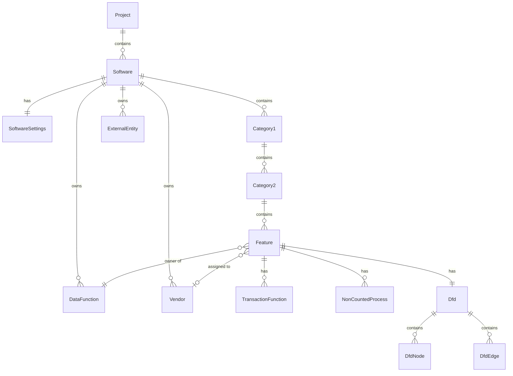

# 要件定義書: FP法見積もり用 DFD GUIエディタ

- 版: 1.0（2026-11-02）
- 原案: [concept.md](./concept.md)
- 本書は concept.md のアイデアを、ヒアリングで確定した決定事項とともに要件として整理したものである。concept.md に記載のない事項は「9. 前提・未決事項」に分離して記載し、レビューで修正できるようにしている。

---

## 1. 概要

### 1.1 目的

ソフトウェア開発の見積もり担当者が、ファンクションポイント法（FP法）による工数・費用見積もりを行うために、ソフトウェアの機能をデータフローダイアグラム（DFD）として描きながらファンクションを数え上げ、見積もり値を自動計算できるGUIエディタを提供する。

### 1.2 対象ユーザー

- 見積もり担当者（SE、PM）。FP法の基本（ILF/EIF/EI/EO/EQ、システム特性）を理解していることを前提とする。
- 単一ユーザーが自分のPC上で利用する。複数人での同時編集は対象外。

### 1.3 動作形態

- ブラウザ単体で動作するWebアプリケーション（シングルページアプリケーション）。サーバーは不要。
- 編集中データはブラウザの localStorage に自動バックアップし、手動保存は JSON ファイルのダウンロードで行う。

### 1.4 スコープ外（初版）

- サーバー連携、複数人での共有・同時編集
- 多言語対応（UIは日本語のみ）
- DET/RET/FTR からの複雑度自動判定
- 階層化DFD（コンテキスト図からの段階的詳細化）
- 全機能のDFDを一括でZIP出力する機能

---

## 2. 用語定義

| 用語 | 定義 |
|---|---|
| プロジェクト | 見積もりの単位となる最上位の入れ物。複数のソフトウェアを含む。 |
| ソフトウェア | 見積もり対象の1つのシステム／アプリケーション。機能階層、共通設定、ファンクション、外部エンティティを持つ。 |
| 機能階層 | 大分類 → 中分類 → 小分類 の3階層。小分類が見積もりの最小単位（以下、単に「機能」と呼ぶ）。 |
| 機能 | 小分類のこと。DFDを1枚持ち、FP値・工数・費用が算出される単位。 |
| データファンクション | ILF（内部論理ファイル）または EIF（外部インタフェースファイル）。DFD上ではデータストアとして描く。ソフトウェア内で一意のIDを持つ。 |
| トランザクションファンクション | EI（外部入力）、EO（外部出力）、EQ（外部照会）。DFD上ではプロセスとして描く。 |
| 非計上プロセス | トランザクションファンクションではない内部処理。DFD上ではプロセスとして描くがFPには計上しない。 |
| 外部エンティティ | ソフトウェア外部からの入力元、またはソフトウェア外部への出力先（利用者、外部システムなど）。FPには計上しない。 |
| 所有機能 | データファンクションのFPを計上する機能。1つのデータファンクションに対してちょうど1つ。 |
| 参照 | 所有機能以外の機能のDFDに、既存のデータファンクションまたは外部エンティティを配置すること。参照先ではFPに計上しない。 |
| 開発区分 | 機能ごとの「新規」または「改修」。 |
| 外注業者 | ソフトウェア共通設定として登録する外部委託先。機能ごとに1社を選択する。 |
| 説明 | 機能および各ファンクション・非計上プロセス・外部エンティティに付ける自由記述。DFD にその要素を配置した理由や補足を記録する任意項目。 |

---

## 3. データモデル

### 3.1 エンティティ関係



### 3.2 エンティティ定義

#### Project

| 属性 | 型 | 説明 |
|---|---|---|
| id | string | 一意ID |
| name | string | プロジェクト名 |
| softwares | Software[] | 含まれるソフトウェア |

#### Software

| 属性 | 型 | 説明 |
|---|---|---|
| id | string | 一意ID |
| name | string | ソフトウェア名 |
| settings | SoftwareSettings | 共通設定 |
| categories | Category1[] | 大分類の配列（表示順） |
| dataFunctions | DataFunction[] | ソフトウェア内の全データファンクション |
| externalEntities | ExternalEntity[] | ソフトウェア内の全外部エンティティ |
| vendors | Vendor[] | 外注業者リスト |

#### SoftwareSettings（ソフトウェア共通設定）

| 属性 | 型 | 単位 | 説明 |
|---|---|---|---|
| defaultCharacteristics | number[14] | 0〜5 | C1〜C14 の既定値。新規機能作成時にコピーされる |
| newDev.modificationFactor | number | — | 開発区分「新規」の改修係数。初期値 1.00 |
| newDev.hoursPerFp | number | H/FP | 開発区分「新規」の1FPあたり工数 |
| modDev.modificationFactor | number | — | 開発区分「改修」の改修係数。初期値 1.00 |
| modDev.hoursPerFp | number | H/FP | 開発区分「改修」の1FPあたり工数 |
| inHouseRatio | number | 0〜1 | 社内への工数配分比率 |
| inHouseRate | number | 円/H | 社内の工数単価 |

> concept.md では「FP単位の工数」の単位を「FP/H」としているが、計算式（調整済みFP × 改修係数 × FP単位工数 ＝ 工数[H]）との整合から **H/FP** が正しい。本書では H/FP を採用する。

#### Category1 / Category2（大分類 / 中分類）

| 属性 | 型 | 説明 |
|---|---|---|
| id | string | 一意ID |
| name | string | 分類名 |
| children | Category2[] / Feature[] | 子要素（表示順） |

#### Feature（機能＝小分類）

| 属性 | 型 | 説明 |
|---|---|---|
| id | string | 一意ID |
| name | string | 機能名 |
| devType | "new" \| "modification" | 開発区分 |
| characteristics | number[14] | C1〜C14（各 0〜5） |
| vendorId | string \| null | 選択した外注業者 |
| transactionFunctions | TransactionFunction[] | この機能に属するトランザクションファンクション |
| nonCountedProcesses | NonCountedProcess[] | この機能に属する非計上プロセス |
| description | string | 説明（任意、複数行可）。この機能の概要 |
| dfd | Dfd | この機能のDFD |

#### DataFunction

| 属性 | 型 | 説明 |
|---|---|---|
| id | string | ソフトウェア内で一意のID（表示用に `DF-001` 形式の連番も持つ） |
| name | string | 名称 |
| kind | "ILF" \| "EIF" | 種別 |
| complexity | "low" \| "medium" \| "high" | 複雑度 |
| ownerFeatureId | string \| null | 所有機能。null は「所有機能未設定」（警告対象） |
| description | string | 説明（任意、複数行可）。配置理由や補足 |

#### TransactionFunction

| 属性 | 型 | 説明 |
|---|---|---|
| id | string | ソフトウェア内で一意のID（表示用 `TF-001` 形式） |
| name | string | 名称 |
| kind | "EI" \| "EO" \| "EQ" | 種別 |
| complexity | "low" \| "medium" \| "high" | 複雑度 |
| featureId | string | 所属機能（ちょうど1つ） |
| description | string | 説明（任意、複数行可）。配置理由や補足 |

#### NonCountedProcess

| 属性 | 型 | 説明 |
|---|---|---|
| id | string | 一意ID |
| name | string | 名称 |
| featureId | string | 所属機能 |
| description | string | 説明（任意、複数行可）。配置理由や補足 |

#### ExternalEntity

| 属性 | 型 | 説明 |
|---|---|---|
| id | string | ソフトウェア内で一意のID（表示用 `EE-001` 形式） |
| name | string | 名称 |

#### Vendor（外注業者）

| 属性 | 型 | 単位 | 説明 |
|---|---|---|---|
| id | string | — | 一意ID |
| name | string | — | 業者名 |
| rate | number | 円/H | 工数単価 |

#### Dfd / DfdNode / DfdEdge

| エンティティ | 属性 | 説明 |
|---|---|---|
| Dfd | nodes, edges | 機能ごとに1つ |
| DfdNode | id, refType, refId, x, y | refType は dataFunction / transactionFunction / nonCountedProcess / externalEntity。refId で実体を参照する。座標はキャンバス上の位置 |
| DfdEdge | id, sourceNodeId, targetNodeId, label | データフロー。label はフローするデータの名称（任意） |

---

## 4. 機能要件

要件IDは `FR-<領域>-<連番>` とする。優先度は「必須」「推奨」の2段階。

### 4.1 プロジェクト・ソフトウェア管理

| ID | 要件 | 優先度 |
|---|---|---|
| FR-PJ-01 | プロジェクトを新規作成し、名称を設定・変更できる。 | 必須 |
| FR-PJ-02 | プロジェクトにソフトウェアを複数追加・改名・削除できる。 | 必須 |
| FR-PJ-03 | ソフトウェア削除時は確認ダイアログを表示する。 | 必須 |
| FR-PJ-04 | ソフトウェアの共通設定（3.2 SoftwareSettings、外注業者リスト）を編集できる。 | 必須 |
| FR-PJ-05 | 外注業者は複数登録でき、名称と工数単価（円/H）を設定できる。機能で使用中の業者を削除する場合は警告し、削除後は該当機能の業者を未選択にする。 | 必須 |

### 4.2 機能階層の管理

| ID | 要件 | 優先度 |
|---|---|---|
| FR-CT-01 | 大分類・中分類・小分類（機能）を追加・改名・削除できる。 | 必須 |
| FR-CT-02 | 大分類・中分類・機能の並べ替えができる。ツリー上のドラッグ＆ドロップで、同じ階層の行の前後に入れ替えるほか、機能を別の中分類へ、中分類を別の大分類へ移せる。別のソフトウェアへは移せない。メニューの「上へ移動」「下へ移動」でも並べ替えられ、「別の中分類へ移動…」（機能）「別の大分類へ移動…」（中分類）で移動先を一覧から選んで移せる。並べ替えは Undo できる。 | 推奨 |
| FR-CT-03 | 大分類・中分類を削除すると配下の要素も削除する。削除前に確認ダイアログを表示し、配下の件数を示す。 | 必須 |
| FR-CT-04 | 機能を削除した場合、その機能が所有するデータファンクションは削除せず「所有機能未設定」とし、一覧とDFDで警告表示する。他機能からの参照も維持する。 | 必須 |
| FR-CT-05 | 機能を新規作成した時点で、C1〜C14 にソフトウェア共通設定の既定値をコピーし、開発区分は「新規」とする。 | 必須 |

### 4.3 ファンクション入力（表形式）

| ID | 要件 | 優先度 |
|---|---|---|
| FR-FN-01 | 機能ごとに、データファンクション（ILF/EIF）とトランザクションファンクション（EI/EO/EQ）を表形式で追加・編集・削除できる。 | 必須 |
| FR-FN-02 | 各ファンクションに名称、種別、複雑度（低・中・高）を設定できる。複雑度は手動選択とする。 | 必須 |
| FR-FN-03 | データファンクションを表で追加した場合、所有機能は現在編集中の機能になる。所有機能は後から変更できる。 | 必須 |
| FR-FN-04 | 他機能が所有するデータファンクションを、現在の機能に「参照」として追加できる（既存のデータファンクション一覧から選択）。 | 必須 |
| FR-FN-05 | 機能ごとに C1〜C14 を 0〜5 の整数で入力できる。入力欄には各特性の名称（例: C1 データ通信）を表示する。 | 必須 |
| FR-FN-06 | 「共通設定の既定値で上書き」ボタンで、現在の機能の C1〜C14 を既定値に戻せる。 | 推奨 |
| FR-FN-07 | 機能ごとに開発区分（新規／改修）を設定できる。 | 必須 |
| FR-FN-08 | 機能ごとに外注業者を1社選択できる（未選択も可）。 | 必須 |
| FR-FN-09 | 表の編集内容は即座にDFDに反映される（4.4 の双方向同期）。 | 必須 |
| FR-FN-10 | 機能一覧画面では、全機能の計算結果（未調整FP、調整係数、調整済みFP、開発工数、社内工数、外注工数、開発単価）を一覧表示し、合計行を表示する。 | 必須 |
| FR-FN-11 | 機能ごとに説明（複数行の自由記述、任意）を入力できる。 | 必須 |
| FR-FN-12 | 各データファンクション・トランザクションファンクション・非計上プロセス・外部エンティティに説明（複数行の自由記述、任意）を入力できる。配置理由の記録を目的とし、ファンクション表とプロパティパネルの両方から編集できる。 | 必須 |
| FR-FN-13 | 選択中の機能の開発単価と、同じソフトウェア内の全機能の開発単価の合計を、表示中のタブや選択中のノードに関係なく常に見える固定領域に表示する。機能未選択時は合計のみ表示する。 | 必須 |
| FR-FN-14 | ファンクション表の各行（データファンクション、トランザクションファンクション、非計上プロセス、外部エンティティ）を複製できる。複製時は種別・複雑度・説明を引き継ぎ、名称を入力し直すダイアログを表示する。複製したものは別の実体として同じ機能に属し、DFD の元のノードの近くに配置する。参照として配置している他機能所有の要素は複製できない。 | 必須 |
| FR-FN-15 | ファンクション表の各行およびプロパティパネルから、同じ機能のファンクション表に並ぶ別の要素への接続（データフロー）を追加できる。向き（出力／入力）、相手、ラベルを指定する。接続ルール（FR-DF-06）に反する相手は選べない。未配置の要素は接続と同時に DFD へ自動配置する。ファンクション表には各行の接続数を表示する。 | 必須 |
| FR-FN-16 | ファンクション表画面に、選択中の機能の DFD を縮小表示する。閲覧専用とし、ズームと移動、ノードの選択ができる。選択はファンクション表の行と連動する。表示・非表示の切り替えと高さの調整ができ、その設定はブラウザごとに保持する。 | 推奨 |
| FR-FN-17 | 機能内の文言を一括置換できる。対象はその機能に属するトランザクションファンクション・非計上プロセスと、その機能が所有するデータファンクションの名称・説明、およびその機能の DFD のデータフローのラベル。置換前後を一覧で確認し、行ごとに対象を外せる。外部エンティティと他機能所有のデータファンクションは共有されているため対象外。DFD のコピー（FR-DF-20）の直後は、コピーで追加したものだけを対象に置換できる。置換は 1 回の Undo で戻せる。 | 推奨 |
| FR-FN-18 | ファンクション表で行をチェックボックスで複数選び、まとめてコピーできる。コピー先は同じ機能か、同じソフトウェアの別の機能。トランザクションファンクション・非計上プロセスと、この機能が所有するデータファンクションは新しい番号で複製し、コピーと同時に名称・説明・データフローのラベルの文言を置換できる（置換前後を一覧で確認できる）。外部エンティティと他機能所有のデータファンクションは共有のまま使う。選んだ要素どうしをつなぐデータフローも、任意でコピーできる。置換後に既存と同じ名称になるものには印を出す。コピーは 1 回の Undo で戻せる。 | 推奨 |
| FR-FN-19 | ファンクション表で行をチェックボックスで複数選び、データファンクション・外部エンティティを、番号（ID）はそのままで同じソフトウェアの他の機能（複数可）の DFD に参照として配置できる。配置済みの要素は飛ばす。トランザクションファンクション・非計上プロセスは機能に属するため参照できず、その旨を表示する（複製は FR-FN-18）。データファンクションの FP は所有機能にのみ計上する。配置は 1 回の Undo で戻せる。 | 推奨 |

### 4.4 DFD編集

#### 4.4.1 記法とノード種別

Yourdon/DeMarco 記法を採用する。

| ノード種別 | 図形 | 対応する実体 | FP計上 |
|---|---|---|---|
| プロセス（トランザクションファンクション） | 円。内部に種別バッジ（EI/EO/EQ）と名称 | TransactionFunction | 所属機能に計上 |
| プロセス（非計上プロセス） | 円（破線または淡色）。名称のみ | NonCountedProcess | 計上しない |
| データストア | 上下2本の平行線で挟んだ名称。左端に種別バッジ（ILF/EIF） | DataFunction | 所有機能にのみ計上 |
| 外部エンティティ | 四角 | ExternalEntity | 計上しない |
| データフロー | 矢印付きの線。ラベル任意 | DfdEdge | — |

参照ノード（他機能が所有するデータファンクション、および外部エンティティ）は同じ図形で描き、データストアの場合はラベル下部に「所有: <所有機能名>」を補記する。

#### 4.4.2 要件

| ID | 要件 | 優先度 |
|---|---|---|
| FR-DF-01 | 機能（小分類）ごとに1枚のDFDキャンバスを持ち、機能ツリーで選択した機能のDFDを表示する。 | 必須 |
| FR-DF-02 | パレットまたはコンテキストメニューから、トランザクションファンクション／非計上プロセス／データファンクション（新規）／外部エンティティ（新規）をキャンバスに追加できる。追加時に名称・種別・複雑度・説明（任意）を入力するダイアログを表示する。 | 必須 |
| FR-DF-03 | 既存のデータファンクション・外部エンティティを一覧から選んで「参照」として配置できる。同一DFD内に同じデータファンクションを2回配置することはできない。外部エンティティは FR-DF-18 により複数配置できる。 | 必須 |
| FR-DF-04 | ノードをドラッグで移動できる。座標は保存対象とする。 | 必須 |
| FR-DF-05 | ノード間をドラッグしてデータフロー（エッジ）を接続できる。エッジにはラベルを設定できる。 | 必須 |
| FR-DF-06 | 接続ルール: 外部エンティティ同士、データストア同士、外部エンティティとデータストアの直接接続は禁止し、接続時に理由を表示する。プロセスを介した接続のみ許可する。 | 必須 |
| FR-DF-07 | ノードを選択するとプロパティパネルで名称・種別・複雑度・所有機能を編集できる。編集内容は表にも即時反映される。 | 必須 |
| FR-DF-08 | キャンバス上でノードを削除した場合の挙動: トランザクションファンクション・非計上プロセスは実体ごと削除する。データファンクション・外部エンティティは「配置の解除」と「実体の削除」を選択させる。実体の削除は他機能から参照されていない場合のみ可能とする。 | 必須 |
| FR-DF-09 | 表で追加・削除したファンクションはDFDに自動反映される。表で追加したノードは、キャンバスの空き位置に自動配置する。 | 必須 |
| FR-DF-10 | Undo / Redo をDFD編集と表編集の両方で提供する。履歴は機能切り替えをまたいで保持する（最低50段階）。 | 必須 |
| FR-DF-11 | キーボードショートカット: 保存（Ctrl/Cmd+S）、Undo（Ctrl/Cmd+Z）、Redo（Ctrl/Cmd+Shift+Z）、削除（Delete / Backspace）、全選択（Ctrl/Cmd+A）、コピー／ペースト（Ctrl/Cmd+C / V、同一ソフトウェア内）。 | 必須 |
| FR-DF-12 | 自動整列ボタンで、現在のDFDのノードを階層レイアウト（外部エンティティ→プロセス→データストアの流れが左から右になる配置）に整列できる。整列時は外部エンティティをシステム境界の外（入力元は左、出力先だけのものは右）、EIF を境界の下の外側に置く（FR-DF-19）。整列は Undo 可能とする。 | 必須 |
| FR-DF-13 | キャンバスのズーム（マウスホイール、＋／−ボタン、全体表示）とパン（ドラッグ）ができる。 | 必須 |
| FR-DF-14 | ミニマップを表示できる。 | 推奨 |
| FR-DF-15 | 所有機能未設定のデータファンクション、未接続のノードを警告色で表示する。 | 推奨 |
| FR-DF-16 | 説明が入力されているノードにはアイコンを表示し、ホバーで説明をツールチップ表示する。説明は図形内には描画しない。 | 推奨 |
| FR-DF-17 | DFD に凡例を表示し、種別（EI / EO / EQ / ILF / EIF）ごとのファンクション数、合計件数、未調整 FP を示す。件数は FP の計上と同じ数え方（所有 DF と所属 TF）とし、参照配置した他機能所有の DF は「参照（計上外）」として別に示す。DFD に未配置の計上ファンクションがあれば件数を注記する。凡例は折りたためる。SVG 出力にも同じ凡例を描画する。 | 推奨 |
| FR-DF-18 | 同じ外部エンティティを 1 つの DFD に複数配置できる。入力元と出力先を別のノードに分け、データフローを左から右へ一方向に描けるようにする。外部エンティティのノードから「入力側と出力側に分ける」操作で、出力側のノードを図の右端に追加し、そのノードへ入るデータフローを付け替える。複数配置した外部エンティティには DFD の慣例に従い左上の角に斜線を描き、SVG 出力にも描く。ファンクション表では 1 行にまとめ、接続数は全ノードの合計とする。FP の計上には影響しない。 | 推奨 |
| FR-DF-19 | DFD にシステム境界（ソフトウェアの内部と外部の境界）を角丸の四角で描き、「システム境界: ソフトウェア名」と表示する。境界は内部の要素（トランザクションファンクション、非計上プロセス、ILF。参照配置した ILF を含む）を囲み、外部エンティティと EIF は外側とする。ノードの移動に追従して自動で大きさを変え、選択やクリックの対象にはしない。ファンクション表のプレビューと SVG 出力にも描く。 | 推奨 |
| FR-DF-20 | 機能の DFD を、同じソフトウェア内の別の機能へコピーできる。トランザクションファンクションと非計上プロセスは新しい番号で複製してコピー先に属させ、外部エンティティは同じものを配置し、データフローはラベルとともに再現する。コピー元が所有するデータファンクションは「参照として配置」か「複製してコピー先の所有にする」かを選べ、他機能所有のものは参照として配置する。コピー先に DFD があれば重ならない位置に追加する。コピーは 1 回の Undo で戻せる。別のソフトウェアへはコピーできない。 | 推奨 |
| FR-DF-21 | 既存を参照のダイアログで「複製して配置」を選ぶと、同じソフトウェアのデータファンクション・トランザクションファンクション・外部エンティティから 1 つを選び、名称・種別・複雑度・説明をコピーした新しい要素（新しい番号）としてこの機能に追加し、DFD に配置できる。追加前に名称などを変えられる。複製したデータファンクションはこの機能の所有になる。 | 推奨 |
| FR-DF-22 | DFD に配置したデータファンクション・外部エンティティを、同じソフトウェアの既存の同種の要素への参照に置き換えられる（別の番号で重複して追加した要素をまとめるため）。範囲は「元の要素を置いているすべての DFD」か「選択中のノードだけ」を選べる。データフローは引き継ぎ、置き換え先のデータファンクションが同じ DFD に配置済みならそのノードに統合する。置き換え後どこにも配置されていない元の要素は、選択により削除する。置き換えは 1 回の Undo で戻せる。 | 推奨 |
| FR-DF-23 | DFD 上のノードをダブルクリックすると、そのノードを選択してプロパティパネルの名称欄にフォーカスし、名称を全選択する（そのまま入力して名称を変更できる）。データフローのダブルクリックではラベル欄にフォーカスする。ダブルクリックで図はズームしない。 | 推奨 |
| FR-DF-24 | DFD の要素（プロセス・データストア・外部エンティティ）の名称は省略せずに表示する。高さは種別ごとに名称 2 行が入る値で固定し、既定の大きさで 1 行に収まらない名称は、2 行に収まる幅まで要素を横に伸ばす（プロセスは横長の楕円になる）。SVG 出力も同じ大きさで描く。 | 推奨 |

### 4.5 二重計上防止

| ID | 要件 | 優先度 |
|---|---|---|
| FR-ID-01 | データファンクション、トランザクションファンクション、外部エンティティは作成時にソフトウェア内で一意のIDを自動採番する。IDはユーザーが変更できない。 | 必須 |
| FR-ID-02 | データファンクションのFPは所有機能にのみ計上し、参照として配置した機能では計上しない。 | 必須 |
| FR-ID-03 | トランザクションファンクションはちょうど1つの機能に属し、その機能にのみ計上する。 | 必須 |
| FR-ID-04 | 同一ソフトウェア内で同名・同種別のファンクションを新規作成しようとした場合、既存の実体を参照する選択肢を提示して警告する（作成自体は許可する）。 | 必須 |
| FR-ID-05 | ソフトウェア単位で「ファンクション台帳」画面を提供し、全データファンクション・トランザクションファンクションをID、名称、種別、複雑度、所有／所属機能、参照している機能の一覧、説明とともに表示する。 | 必須 |
| FR-ID-06 | ファンクション台帳を CSV 出力できる。列は「No,名称,種別,複雑度,FP,所有／所属機能,参照している機能,説明」とし、文字コード等は FR-CSV-02 に従う。ファイル名は `<ソフトウェア名>_台帳_<YYYYMMDD-HHmm>.csv`。 | 必須 |
| FR-ID-07 | データファンクションの所有機能を、そのデータファンクションを参照として置いている別の機能に移せる。プロパティパネルに置いている機能の一覧を表示して「所有を移す」を選べるほか、ファンクション表の参照行から「所有をこの機能に移す」を選べる。元の所有機能の DFD には参照として残り、FP の計上先が移ったことを通知する。1 回の Undo で戻せる。 | 推奨 |

### 4.6 計算仕様

すべて機能（小分類）単位で算出し、ソフトウェア単位で合計する。切り捨ては「小数点以下切り捨て」を意味する。

#### 4.6.1 未調整FP値

ファンクションの種別と複雑度ごとの件数に以下の係数を乗じ、全組み合わせを合計する。

| 種別 | 低 | 中 | 高 |
|---|---|---|---|
| ILF | 7 | 10 | 15 |
| EIF | 5 | 7 | 10 |
| EI | 3 | 4 | 6 |
| EO | 4 | 5 | 7 |
| EQ | 3 | 4 | 6 |

データファンクションは所有機能にのみ件数を数える（FR-ID-02）。

#### 4.6.2 調整係数

```
調整係数 = 0.65 + 0.01 × (C1 + C2 + … + C14)
```

取りうる範囲は 0.65〜1.35。小数第2位まで表示する。

#### 4.6.3 調整済みFP値

```
調整済みFP値 = 切り捨て(未調整FP値 × 調整係数)
```

#### 4.6.4 開発工数

```
開発工数[H] = 切り捨て(調整済みFP値 × 改修係数 × FP単位工数[H/FP])
```

改修係数と FP単位工数は、機能の開発区分（新規／改修）に対応するソフトウェア共通設定の値を使う。

#### 4.6.5 社内工数・外注工数

```
社内工数[H] = 切り捨て(開発工数 × 社内配分比率)
外注工数[H] = 開発工数 − 社内工数
```

外注工数は機能で選択した外注業者に割り当てる。外注工数が 0 より大きいのに業者が未選択の場合は警告を表示し、開発単価の外注分は 0 として計算する。

#### 4.6.6 開発単価（機能ごとの費用）

```
開発単価[円] = 社内工数 × 社内単価 + 外注工数 × 選択した外注業者の単価
```

#### 4.6.7 合計

ソフトウェア単位で、未調整FP値、調整済みFP値、開発工数、社内工数、外注業者ごとの外注工数、開発単価をそれぞれ合計する。プロジェクト単位でも全ソフトウェアの合計を表示する。

#### 4.6.8 再計算タイミング

入力値の変更時に即時再計算し、表・プロパティパネルに反映する。

#### 4.6.9 計算例

共通設定: 新規の改修係数 1.00、新規の FP単位工数 8.0 H/FP、社内配分比率 0.40、社内単価 6,000 円/H、外注A社 5,000 円/H

機能「顧客登録」（新規、外注A社）のファンクション:

| 種別 | 名称 | 複雑度 | 係数 |
|---|---|---|---|
| ILF（所有） | 顧客マスタ | 中 | 10 |
| EI | 顧客登録入力 | 中 | 4 |
| EO | 登録完了通知 | 低 | 4 |
| EQ | 顧客検索 | 低 | 3 |

C1〜C14 = 3,2,3,2,1,2,3,2,1,1,2,3,2,1（合計 28）

| 項目 | 計算 | 結果 |
|---|---|---|
| 未調整FP値 | 10 + 4 + 4 + 3 | 21 |
| 調整係数 | 0.65 + 0.01 × 28 | 0.93 |
| 調整済みFP値 | 切り捨て(21 × 0.93 = 19.53) | 19 |
| 開発工数 | 切り捨て(19 × 1.00 × 8.0) | 152 H |
| 社内工数 | 切り捨て(152 × 0.40 = 60.8) | 60 H |
| 外注工数（A社） | 152 − 60 | 92 H |
| 開発単価 | 60 × 6,000 + 92 × 5,000 | 820,000 円 |

### 4.7 CSV出力

| ID | 要件 | 優先度 |
|---|---|---|
| FR-CSV-01 | ソフトウェア単位で、全機能（小分類）を1行ずつ出力したCSVファイルをダウンロードできる。 | 必須 |
| FR-CSV-02 | 文字コードは UTF-8（BOM付き）、改行は CRLF、区切りはカンマ。値にカンマ・改行・ダブルクォートを含む場合はダブルクォートで囲む。 | 必須 |
| FR-CSV-03 | 1行目はヘッダとする。カラム順は以下のとおり。外注工数のカラムは登録済み外注業者ごとに「外注工数（<業者名>）」として設ける。 | 必須 |
| FR-CSV-04 | 外注工数カラムは、機能で選択した業者の列にのみ値を出力し、他の業者の列は空とする。 | 必須 |
| FR-CSV-05 | ファイル名は `<ソフトウェア名>_<YYYYMMDD-HHmm>.csv` とする。 | 推奨 |

ヘッダ（外注業者がA社・B社の場合）:

```
機能名（大分類）,機能名（中分類）,機能名（小分類）,ILF,EIF,EI,EO,EQ,C1,C2,C3,C4,C5,C6,C7,C8,C9,C10,C11,C12,C13,C14,開発区分,未調整FP値,調整係数,調整済FP値,改修係数,開発工数,社内工数,外注工数（A社）,外注工数（B社）,開発単価,説明
```

カラム仕様:

| カラム | 内容 |
|---|---|
| ILF, EIF, EI, EO, EQ | その機能に計上されるファンクションの件数（複雑度を問わない合計件数）。データファンクションは所有機能の行にのみ数える |
| C1〜C14 | 0〜5 の整数 |
| 開発区分 | 「新規」または「改修」 |
| 調整係数、改修係数 | 小数第2位まで |
| 開発工数、社内工数、外注工数 | 整数（H） |
| 開発単価 | 整数（円） |
| 説明 | 機能の説明。改行・カンマを含む場合はダブルクォートで囲む（FR-CSV-02） |

### 4.8 SVG出力

| ID | 要件 | 優先度 |
|---|---|---|
| FR-SVG-01 | 表示中の機能のDFDを、SVGファイルとしてダウンロードできる。 | 必須 |
| FR-SVG-02 | 出力範囲はノード全体を含む矩形に余白を加えたものとし、ズーム状態に依存しない。 | 必須 |
| FR-SVG-03 | 図形・バッジ・ラベル・所有機能の補記を画面表示と同じ見た目で出力する。フォントは `font-family` に日本語フォント（例: "Hiragino Sans", "Noto Sans JP", "Meiryo", sans-serif）を指定する。 | 必須 |
| FR-SVG-04 | SVG上部にタイトルとして「<ソフトウェア名> / <大分類> / <中分類> / <機能名>」を描画する。 | 推奨 |
| FR-SVG-05 | ファイル名は `<ソフトウェア名>_<機能名>.svg` とする。 | 推奨 |
| FR-SVG-06 | SVG 出力には FR-DF-17 の凡例を図の右側に描画する。凡例はノードと重ならない位置に置く。 | 推奨 |

### 4.9 保存・読み込み

| ID | 要件 | 優先度 |
|---|---|---|
| FR-SV-01 | 手動保存: ツールバーのボタンまたは Ctrl/Cmd+S で、プロジェクト全体を1つの JSON ファイルとしてダウンロードする。ファイル名は `<プロジェクト名>.fpdfd.json`。 | 必須 |
| FR-SV-02 | JSON にはスキーマバージョンを含め、将来の形式変更時に移行できるようにする。 | 必須 |
| FR-SV-03 | 自動バックアップ: 編集内容を定期的に localStorage に保存する。間隔の既定値は1分、保持世代数の既定値は10。いずれも設定画面で変更できる。変更がない場合は新しい世代を作らない。 | 必須 |
| FR-SV-04 | 起動時に最新のバックアップを自動で読み込んで表示する。バックアップがない場合は空のプロジェクトを表示する。 | 必須 |
| FR-SV-05 | 手動読み込み: JSON ファイルを選択して読み込める。バックアップ一覧（保存日時付き）から世代を選択して読み込める。 | 必須 |
| FR-SV-06 | 読み込み時に現在の編集内容が未保存（最後の手動保存またはバックアップ以降に変更あり）であれば確認ダイアログを表示する。 | 必須 |
| FR-SV-07 | 読み込むファイルのスキーマバージョンが対応外の場合はエラーを表示し、現在の状態を維持する。 | 必須 |
| FR-SV-08 | 未保存の変更がある状態でタブを閉じようとした場合、ブラウザの離脱確認を表示する。 | 推奨 |
| FR-SV-09 | localStorage の容量上限に近づいた場合（保存失敗時）、警告を表示し、手動保存を促す。 | 必須 |

### 4.10 AI エージェント連携

Microsoft Copilot のエージェントに DFD の作成・見直しを手伝ってもらうための入出力。複数の機能の DFD を参考に、同じ種類の別の機能の DFD をまとめて作ってもらうこともできる。手順とエージェントに与える指示は [copilot-agent.md](copilot-agent.md) に記載する。

| ID | 要件 | 優先度 |
|---|---|---|
| FR-IO-01 | 選んだ機能（1 つ・複数・すべて）の DFD を、AI エージェントが読める JSON（交換形式 `fp-dfd-exchange`）で書き出せる。JSON には作業ルールの要約、機能ごとの分類・名称・説明と DFD の要素（外部エンティティ・データファンクション・トランザクションファンクション・非計上プロセス）とデータフロー、同じソフトウェアの既存の分類・機能・外部エンティティ・データファンクションの一覧を含む。要素は表示番号などの key で、機能は内部 ID で識別する。DFD に置いていない要素には `placed: false` を付ける。入力側と出力側の 2 か所に分けて置いた外部エンティティ（FR-DF-18）には `split: true` を付け、取り込み時は `split: true` の外部エンティティを 2 か所に置いて、送り出すデータフローは左、受け取るデータフローは右のノードにつなぐ。依頼文と JSON をまとめてクリップボードにコピーでき、ファイルにも保存できる。 | 推奨 |
| FR-IO-02 | エージェントが返した JSON（DFD の完成形）を取り込める。返答全体を貼り付けても JSON のコードブロックだけを読む。JSON を保存したファイル（.json・.txt・.md）を、ファイル選択またはダイアログへのドラッグ＆ドロップで読み込むこともできる。今の DFD との差分（要素の追加・参照配置・変更、データフローの追加・ラベル変更、出力にない要素・データフローの削除）を一覧で確認してから反映する。出力にない要素の削除は選択式で、既定では追加と変更だけを行う。接続ルール違反・存在しない key・key の重複・他の機能のトランザクションの key はエラーとして示し、取り込まない。他機能所有のデータファンクションへの変更は反映せず、警告を出す。取り込みは 1 回の Undo で戻せ、既定で取り込み後に自動整列する。 | 推奨 |
| FR-IO-03 | エージェントに与える指示（プロンプト）をアプリからコピーできる。指示には交換形式の読み方、種別と複雑度（IFPUG の目安）の判定基準、接続ルール、key のルール、返答の形式を含める。指示を設定していないエージェント向けに、依頼文と JSON に指示を含めてコピーすることもできる。 | 推奨 |
| FR-IO-04 | 取り込みは複数の機能に対応する。エージェントは作成・変更した機能だけを返す。新しい機能は任意の key と名称・大分類・中分類で表し、取り込み時にその分類の下に作る（分類がなければ作る）。新しい外部エンティティ・データファンクションは同じ key で複数の機能から使え、新しいデータファンクションの所有機能は `owner` で指定する（省略時は最初の機能）。トランザクションファンクション・非計上プロセスの key は機能をまたいで使えない。取り込み前に機能ごとの差分を確認でき、分類・機能の作成を含めて 1 回の Undo で戻せる。版 1（1 機能）の JSON も読み込める。 | 推奨 |
| FR-IO-05 | 機能の開発区分（新規 / 改修）と外注業者をエージェントと受け渡せる。書き出す JSON には機能ごとの開発区分・外注業者名と、登録済みの外注業者の一覧を含める。取り込みでは、既存の機能・新しい機能のどちらにも反映する（外注業者の項目がなければ変えず、空文字・「未選択」は外注なしにする）。登録にない業者名、新規・改修以外の開発区分は警告を出して反映しない。変更は取り込み前の差分一覧に表示する。 | 推奨 |

---

## 5. 画面構成

### 5.1 レイアウト

```
+------------------------------------------------------------------+
| ツールバー: 新規 / 開く / 保存 / Undo / Redo / CSV出力 / SVG出力 / 設定 |
+------------+-------------------------------------+---------------+
| 機能ツリー  | タブ: [DFD] [ファンクション表] [一覧]  | プロパティ     |
| ・ソフトA   |                                     | パネル         |
|  ・大分類   |   DFDキャンバス または 表            |               |
|   ・中分類  |                                     | 選択中ノード／  |
|    ・機能   |                                     | 機能の属性      |
+------------+-------------------------------------+---------------+
| ステータスバー: 最終保存 / 最終バックアップ / 警告件数                 |
+------------------------------------------------------------------+
```

### 5.2 画面と主要操作

| 画面 | 内容 | 主要操作 |
|---|---|---|
| 機能ツリー | プロジェクト → ソフトウェア → 大分類 → 中分類 → 機能のツリー | 追加・改名・削除・並べ替え、機能選択でDFD切り替え |
| DFDタブ | 選択中機能のDFDキャンバス | ノード追加・参照配置・接続・移動・削除、自動整列、ズーム・パン、ミニマップ |
| ファンクション表タブ | 選択中機能のファンクション一覧、C1〜C14、開発区分、外注業者 | 行の追加・編集・削除、参照追加、既定値で上書き |
| 一覧タブ | ソフトウェア内の全機能の計算結果と合計 | 並べ替え、CSV出力 |
| ファンクション台帳 | ソフトウェア内の全データ／トランザクションファンクション（4.5 FR-ID-05） | 所有機能の変更、参照元の確認 |
| プロパティパネル | 選択中ノードまたは機能の属性 | 名称・種別・複雑度・所有機能・ラベルの編集 |
| 設定ダイアログ | ソフトウェア共通設定、外注業者、バックアップ設定 | 編集 |
| バックアップ一覧ダイアログ | 保存日時付きの世代一覧 | 選択して読み込み |

---

## 6. 非機能要件

| ID | 要件 |
|---|---|
| NFR-01 | 対応ブラウザ: 最新版の Chrome、Edge、Firefox（デスクトップ）。モバイルは対象外。 |
| NFR-02 | 性能目安: 1ソフトウェアあたり機能200件、1DFDあたりノード100個・エッジ200本で、操作に対する応答が1秒以内。 |
| NFR-03 | 再計算は入力変更後 100ms 以内に反映する。 |
| NFR-04 | 自動バックアップはUI操作をブロックしない。 |
| NFR-05 | すべてのデータはユーザーのブラウザ内に留まり、外部に送信しない。 |
| NFR-06 | 主要操作はキーボードのみで実行可能とし、フォーカス表示を明示する。 |
| NFR-07 | UIの表示言語は日本語。 |

---

## 7. 制約

- 実装技術: React + TypeScript。DFDキャンバスには React Flow を使用する。
- サーバーを持たない。ビルド成果物は静的ファイルのみで、ローカルファイルまたは任意の静的ホスティングから動作する。
- 保存形式は JSON（手動保存）と localStorage（自動バックアップ）。

---

## 8. concept.md からの変更点

| 項目 | concept.md | 本書 |
|---|---|---|
| FP単位工数の単位 | FP/H | H/FP（計算式との整合のため訂正） |
| C1〜C14 の入力 | 機能ごと | 機能ごと＋ソフトウェア共通の既定値を追加 |
| 二重計上防止の方法 | IDで管理 | ID＋所有機能の概念を追加。参照配置では非計上 |
| DFDの単位 | 未記載 | 機能（小分類）ごとに1枚 |
| 説明項目 | なし | 機能と各ファンクション・非計上プロセス・外部エンティティに「説明」を追加。一覧 CSV 末尾と台帳 CSV に出力 |

---

## 9. 前提・未決事項

以下は concept.md に記載がなく、本書作成時に置いた前提である。レビューで確認・修正すること。

| No. | 前提 | 影響範囲 |
|---|---|---|
| A-01 | トランザクションファンクションと非計上プロセスは、ちょうど1つの機能に属する（複数機能での共有はしない）。 | 3.2、FR-ID-03 |
| A-02 | 外部エンティティはソフトウェア単位で管理し、各機能のDFDに参照として配置する。 | 3.2、FR-DF-03 |
| A-03 | 機能削除時、所有するデータファンクションは削除せず「所有機能未設定」として残す。 | FR-CT-04 |
| A-04 | 改修係数の初期値は新規・改修とも 1.00。FP単位工数の初期値は設けない（未入力時は 0 として扱い警告する）。 | 3.2 |
| A-05 | 自動バックアップの既定は間隔1分、10世代。 | FR-SV-03 |
| A-06 | 保存ファイルはプロジェクト単位で1つの JSON。 | FR-SV-01 |
| A-07 | SVG出力は機能ごとに1ファイル。一括出力は初版スコープ外。 | FR-SV-01、1.4 |
| A-08 | CSVの ILF/EIF/EI/EO/EQ 列は「件数」とする（FP値ではない）。 | 4.7 |
| A-09 | CSVの「開発単価」列は機能ごとの費用（円）を指す。名称は concept.md に合わせて「開発単価」のままとする。 | 4.7 |
| A-10 | 接続ルール（外部エンティティ同士・データストア同士の直接接続禁止）は DFD の一般的な規則に従う。 | FR-DF-06 |
| A-11 | 社内配分比率が 1.0（全て社内）の場合、外注業者が未選択でも警告しない。 | 4.6.5 |

---

## 10. 付録

### 10.1 CSVサンプル

4.6.9 の計算例を1行目、改修の機能を2行目とした例（外注業者: A社、B社）。

```
機能名（大分類）,機能名（中分類）,機能名（小分類）,ILF,EIF,EI,EO,EQ,C1,C2,C3,C4,C5,C6,C7,C8,C9,C10,C11,C12,C13,C14,開発区分,未調整FP値,調整係数,調整済FP値,改修係数,開発工数,社内工数,外注工数（A社）,外注工数（B社）,開発単価,説明
顧客管理,顧客情報,顧客登録,1,0,1,1,1,3,2,3,2,1,2,3,2,1,1,2,3,2,1,新規,21,0.93,19,1.00,152,60,92,,820000,顧客の新規登録。氏名、住所、連絡先を入力し顧客マスタに登録する
顧客管理,顧客情報,顧客検索,0,0,0,0,2,3,2,3,2,1,2,3,2,1,1,2,3,2,1,改修,6,0.93,5,0.50,20,8,,12,108000,既存の検索画面に詳細照会を追加
```

2行目の計算: EQ 低 × 2 = 6、調整済み = 切り捨て(6 × 0.93 = 5.58) = 5、改修の改修係数 0.50・FP単位工数 8.0 → 切り捨て(5 × 0.50 × 8.0) = 20 H、社内 = 切り捨て(20 × 0.40) = 8 H、外注（B社 5,000 円/H）= 12 H、開発単価 = 8 × 6,000 + 12 × 5,000 = 108,000 円。

### 10.2 システム特性 C1〜C14 の名称

| No. | 名称 |
|---|---|
| C1 | データ通信 |
| C2 | 分散データ処理 |
| C3 | 性能 |
| C4 | 高負荷構成 |
| C5 | トランザクション量 |
| C6 | オンラインデータ入力 |
| C7 | エンドユーザー効率 |
| C8 | オンライン更新 |
| C9 | 複雑な処理 |
| C10 | 再利用性 |
| C11 | インストール容易性 |
| C12 | 運用性 |
| C13 | 複数サイト |
| C14 | 変更容易性 |
